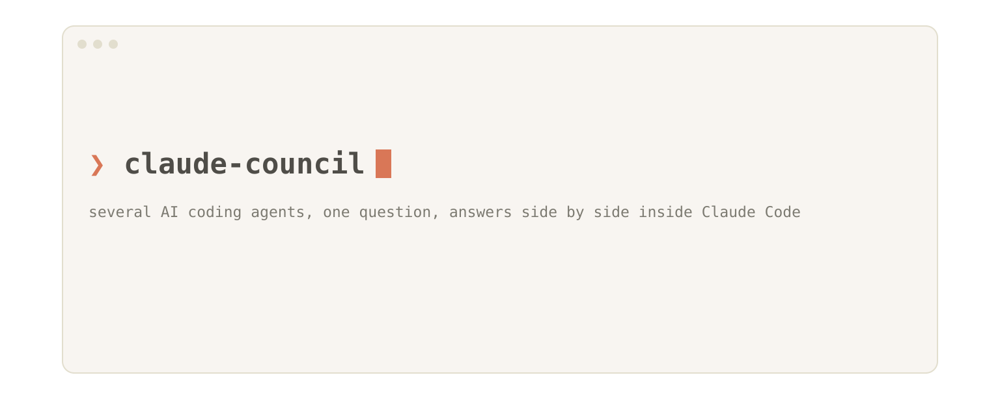

A Claude Code plugin that asks AI coding agents the same question in
parallel. Compare their answers when one model's bias could mislead you:
architecture decisions, debugging dead ends, security reviews, or framework
choices.


[](https://github.com/hex/claude-council/actions/workflows/tests.yml)

## Install

You need `curl` and `jq` on macOS, Linux, or Windows through Git Bash.

```text
/plugin marketplace add hex/claude-marketplace
/plugin install claude-council
```

Give it at least one provider in the shell you start Claude Code from:

```bash
export OPENAI_API_KEY="..."
# Or GEMINI_API_KEY, XAI_API_KEY, PERPLEXITY_API_KEY,
# KIMI_API_KEY, OPENROUTER_API_KEY
```

The `codex`, `agy` (Antigravity), `grok`, `kimi`, and `cursor-agent` CLIs use
your existing subscriptions without an API key. Claude Code itself, the
Copilot CLI and OpenCode can sit too, when named in `--providers`. A local
`ollama` model needs no key or external network. With none of these, `--local` uses Claude
subagents. See [provider selection](docs/REFERENCE.md#choosing-providers) and
[local councils](docs/USAGE.md#local-council---local).

## First run in 60 seconds

Read [what gets sent and saved](docs/REFERENCE.md#what-gets-sent-and-saved)
before asking about your code.

```text
/claude-council:status
/claude-council:ask "Should I use UUID or BIGINT primary keys for a SaaS users table?"
```

Each provider answers independently. Claude writes a synthesis of their
agreement, disagreements, and recommendation. Agreement is not verification:
the models share your description and its assumptions.
[The synthesis names the premise that could change the answer](docs/REFERENCE.md#reading-the-synthesis).

## Features

| Capability | Guide |
|---|---|
| Ask providers together, or name one in plain words | [Command examples](docs/REFERENCE.md#command-examples) |
| Choose providers and pin a standing roster | [Provider selection](docs/REFERENCE.md#choosing-providers) |
| Assign specialist roles | [Roles](docs/USAGE.md#specialized-roles) |
| Have providers challenge each other's answers | [Debate](docs/USAGE.md#debate-mode) |
| Gather code context with agents before asking | [Agent mode](docs/USAGE.md#agent-enhanced-analysis---agents) |
| Use Claude subagents without an external provider | [Local council](docs/USAGE.md#local-council---local) |
| Include relevant files or choose your own | [Auto-context](docs/USAGE.md#auto-context-injection) |
| Attach a screenshot | [Image input](docs/USAGE.md#image-input) |
| Ask about the current conversation | [`/advise`](docs/USAGE.md#asking-about-the-conversation-itself) |
| Run in the background and fetch the result | [Background jobs](docs/USAGE.md#background-jobs---async) |
| Export the answers to a file | [Export](docs/USAGE.md#export-to-file) |
| Show only the synthesis | [Quiet mode](docs/USAGE.md#quiet-mode) |
| Watch answers arrive and retry failed seats | [The pane](#the-pane) |
| Get a note from one seat while Claude works | [Heads-up side-check](#heads-up-side-check) |
| Have a second model review the diff before Claude stops | [Stop-gate review](docs/USAGE.md#stop-gate-review-opt-in-off-by-default) |
| Call the scripts without Claude Code | [Direct script usage](docs/REFERENCE.md#direct-script-usage) |

The [reference](docs/REFERENCE.md) lists every flag, variable, model default,
and limit. [Architecture](docs/ARCHITECTURE.md) covers the implementation.
[TESTING.md](TESTING.md) covers tests, releases, and adding a provider.

## Heads-up side-check



Opt in through the "Heads-up side-check" row in `/config` or the project's
`.claude/council-heads-up.json`. One seat, codex by default, checks recent
turns and tool results while Claude works. For a Write or an Edit, it gets the
text Claude wrote. The note shows what went where.
Learn more expands it; Tell Claude puts a draft in the prompt without sending
it. Read the [data limits and off switch](docs/REFERENCE.md#what-gets-sent-and-saved)
and the [heads-up guide](docs/USAGE.md#heads-up-side-check-opt-in-off-by-default).

## The pane

With `CLAUDE_CODE_ENABLE_FUNCTION_HOOKS=1`, the pane opens inside Claude Code,
as in the animation above. Each seat has one row with its model, a bar for
its state, its time, and a button for what it does now: cancel, retry, open,
or fold. When the run ends,
the synthesis opens at the top with the answers folded below it. Reopen the
last run with `/council-pane`. Inside tmux, the mod asks once which pane you want.

Mods are early access. The [mod guide](mods/council-pane/README.md) lists
keys, settings, and limits. It also lets Claude call the council as a tool;
every call asks you first.

### What the mod runs, reads and sends

The mod makes no network calls of its own. It starts the programs below
from an argument array, never a shell string, and never hands `bash -c` a
script. Your text reaches model providers only through the first two:

- `bash scripts/run-council.sh` when Claude calls the council tool and you
  choose `Send to the council`. It sends your question to the providers you
  set up.
- `bash scripts/heads-up.sh`, only with the heads-up side-check on. It reads
  this session's transcript (by default the last 5 turns and up to 8 tool
  results of 2,000 characters each) and sends that digest to one seat,
  `codex` unless you pick another. The run directory keeps `digest.md` and
  `prompt.md`, exactly what left the machine, until the mod reads the result
  and removes it. The codex seat runs in that directory under a codex home
  of its own: your model and effort, a link to your `auth.json` so a token
  refresh reaches your login (without one, your `CODEX_API_KEY` or
  `OPENAI_API_KEY` signs codex in), and none of your plugins, hooks,
  `AGENTS.md`, skills or MCP servers.
- `bash scripts/seat-info.sh discover`, `model <seat>` or
  `allowlisted <seat>` during `/heads-up setup` and `/heads-up on <seat>`.
  It checks which seats this machine can run and sends nothing.
- `codex debug models` during `/heads-up setup` with the codex seat, to list
  its models. That command belongs to codex, and so does any request it
  makes.
- `kill -0 <pid>` to check a council run is still alive. It sends no
  signal.
- `rm -rf` and `mv -f` on its own run directories under
  `$TMPDIR/council-mod.<session id>`, to clean up a finished run and to
  answer the retry offer.

It writes files in that `$TMPDIR` directory, including `model.json` and
`avoid.txt`, which `heads-up.sh` reads. Outside it, it writes one file,
`.claude/council-heads-up.json` in the project, and only from
`/heads-up setup`, `/heads-up on`, `/heads-up off` or a note's `Turn off`.
That file is the heads-up switch. Claude Code itself does not read it.

It touches the prompt in two places. With `wake_on_async_done` on, it
submits `The background council job <id> has finished. Fetch it with
/claude-council:result <id> and summarise it.` once a background job
finishes. A note's `Tell Claude` puts a draft in the prompt box, and you decide
whether to send it.

It reads the text of each Bash command Claude runs, only to spot a call
to `run-council.sh`. Just before that call it sets `COUNCIL_MOD_PANE_DIR`,
so the run draws in this pane, and clears it when tmux owns the pane. It reads `TMPDIR` and `TMUX`. It turns on the
`claude-council.heads_up` setting only when you pick "every project" in
`/heads-up setup`.



Without the mod, tmux opens a side pane that streams answers and each
provider's status. It offers to retry failed seats. Esc closes it.
`--no-pane` or `COUNCIL_NO_PANE=1` turns it off. Outside both pane modes,
answers arrive in the chat. See [terminal integration](docs/REFERENCE.md#display--terminal-integration).

The council and tmux animations show real answers to
"Should a single-node demo app use SQLite or Postgres?" Codex and Antigravity
use subscriptions; Gemini and OpenAI use their APIs. Kimi is a rate-limit
fixture. The heads-up animation uses a fake seat and a real Claude Code host.
[Capture scripts and raw frames](assets/capture/README.md) record how to
reproduce them.

## What a CLI seat loads

A CLI seat answers the question every other seat gets. Your own agent setup
stays out of it. Every CLI seat runs from an empty directory,
`$TMPDIR/claude-council-seat`, so no project's `CLAUDE.md`, `AGENTS.md`,
rules, skills, hooks or MCP servers reach it. The directory does not limit
which files a seat can read: codex, for one, can read any file by its full
path. The seats below also run under
a home of their own in `$TMPDIR/claude-council-seat-home`, which links only to
what the CLI needs to sign in and start. Both directories are yours alone (mode 700), and a seat
refuses to start when one belongs to another user or is a symlink.

| Seat | No longer loads | Still loads |
|---|---|---|
| `cursor-cli` | Skills and plugins from `~/.cursor`, `~/.claude`, `~/.codex`, `~/.grok` and `~/.agents`, Cursor and Claude hooks, `~/.cursor/mcp.json` | Team commands from your Cursor dashboard (read from the CLI's bundle, not seen in a run) |
| `grok-cli` | Claude plugins, `~/.agents` skills, grok's cross-session memory | Links to your login keychain (macOS) and `~/.docker`, for Docker Desktop's socket. Your `~/.grok` config and the hooks in `~/.grok/hooks`; no grok setting turns those off |
| `antigravity` | On macOS: your `~/.gemini` rules, skills, MCP servers and saved conversations | On Linux: everything under `~/.gemini`, since nobody has confirmed where agy keeps its login there |
| `opencode` | The `~/.claude` and `~/.agents` skills, agents and `CLAUDE.md` | Your login and session history in `~/.local/share/opencode` |
| `codex` | Your plugins, hooks, skills, memories and MCP servers; it runs under a codex home of its own for each question, with your model, effort and a link to `auth.json` | Nothing else. A login kept only in the system keyring cannot follow codex into that home, so the seat runs under your own codex home and the answer opens with a note saying so; set `cli_auth_credentials_store = "file"` and run `codex login` again to isolate it. With no login at all, the seat stops and says so |
| `claude-cli` | The git status and commit instructions a repository adds | Admin policy and your organisation's instructions |
| `kimi-cli`, `copilot-cli` | The project's files | Your home: kimi's hooks in `~/.kimi-code/config.toml`, copilot's skills in `~/.copilot` and `~/.agents` |

Cursor and Antigravity keep the model you picked in their own config. The
seat reads it from your real home and passes it on. On Windows the seats keep
your home, because the native CLIs find it through `USERPROFILE`. See
[seat isolation](docs/ARCHITECTURE.md) for each seat's details.

## Troubleshooting

| Problem | Fix |
|---|---|
| Cloned the repo and nothing loads | Don't clone into `~/.claude/plugins/`. `pluginDirectories` is not a setting. Follow [running from a local clone](docs/REFERENCE.md#running-from-a-local-clone). |
| No providers found | Run `/claude-council:status`. Export keys in the shell that starts Claude Code, or use `--local`. |
| A different model answered | A header such as `grok-4.7 (grok-latest unavailable)` records a [model fallback](docs/REFERENCE.md#model-fallback). Setting that provider's `_MODEL` variable disables fallback. |
| No pane | Use tmux or set `CLAUDE_CODE_ENABLE_FUNCTION_HOOKS=1` for the pane inside Claude Code. |
| Updating | Run `/plugin update claude-council`, then restart Claude Code. |
