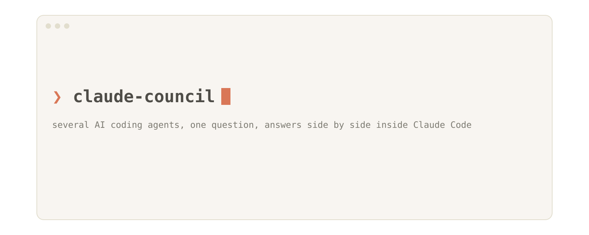

A Claude Code plugin that asks AI coding agents the same question in
parallel. Compare their answers when one model's bias could mislead you:
architecture decisions, debugging dead ends, security reviews, or framework
choices.



[](https://github.com/hex/claude-council/actions/workflows/tests.yml)

## Where it runs

| Where | What you get |
| --- | --- |
| Claude Code in a terminal | `/claude-council:ask`, every seat, and the pane beside the chat. |
| Claude Desktop, Code tab | The same plugin and the same commands. The pane opens in Desktop's side panel. |
| Claude Desktop, an ordinary chat | The [Desktop extension](#claude-desktop): five tools, a seat picker and an answers panel in the chat. macOS and Linux. |


In both, Claude can also call the council as a tool. It asks which seats and
how verbose first, then shows a Send card, and nothing leaves your machine
until you confirm it.

claude.ai chat and Cowork run in a sandbox that can block calls to other
providers, so the council does not work there.

## Install

You need `curl` and `jq` on macOS, Linux, or Windows through Git Bash.

```text
/plugin marketplace add hex/claude-marketplace
/plugin install claude-council
```

Give it at least one provider in the shell you start Claude Code from:

```bash
export OPENAI_API_KEY="..."
# Or GEMINI_API_KEY, XAI_API_KEY, PERPLEXITY_API_KEY,
# KIMI_API_KEY, OPENROUTER_API_KEY
```

Or store the keys in the plugin's config. Run `/plugin configure claude-council`,
fill in the API key rows, and choose Save configuration. Claude Code keeps them in
its secure storage, not in a settings file. The council's mod sets each stored
key as its variable for the whole session, so every command Claude Code starts,
in every project, gets the stored key in place of one your shell exports.
The OpenRouter models row takes the model ids `OPENROUTER_MODELS` takes, so
the router's seats need no export either.
Stored keys need Claude Code 2.1.287 or later. The desktop app's plugin
Settings tab takes them too, for sessions on that computer. They never reach
claude.ai chat or Cowork. [API keys](docs/REFERENCE.md#api-keys) covers where they are kept,
when the mod does not load, and how a cleared key behaves.

The `codex`, `agy` (Antigravity), `grok`, `kimi`, and `cursor-agent` CLIs use
your existing subscriptions without an API key. Claude Code itself, the
Copilot CLI and OpenCode can sit too, when named in `--providers`. A local
`ollama` model needs no key or external network. With none of these, `--local` uses Claude
subagents. See [provider selection](docs/REFERENCE.md#choosing-providers) and
[local councils](docs/USAGE.md#local-council---local).

## First run in 60 seconds

Read [what gets sent and saved](docs/REFERENCE.md#what-gets-sent-and-saved)
before asking about your code.

```text
/claude-council:status
/claude-council:ask "Should I use UUID or BIGINT primary keys for a SaaS users table?"
```

Each provider answers independently. Claude writes a synthesis of their
agreement, disagreements, and recommendation. Agreement is not verification:
the models share your description and its assumptions.
[The synthesis names the premise that could change the answer](docs/REFERENCE.md#reading-the-synthesis).

## Claude Desktop

The plugin needs Claude Code. For an ordinary Claude Desktop chat there is a
Desktop extension, `council-<version>.mcpb`, that gives Claude five tools:
`council_ask`, `council_pick`, `council_result`, `council_status` and
`council_settings`. It runs on macOS and Linux only, because it starts the
council's bash scripts.

1. Download `council-<version>.mcpb` from the
   [latest release](https://github.com/hex/claude-council/releases/latest).
   To build it yourself, run `bash extension/build.sh` in a clean checkout.
   It needs `npm` and writes `dist/council-<version>.mcpb`.
2. Double-click the file. Desktop warns that the extension gets access to
   everything on your computer and is not verified by Anthropic. Both hold for
   any extension installed from a file: its server runs as you, with your files
   and network, and Anthropic has not reviewed it. Install only a package you
   built or trust.
3. In Settings, Extensions, Claude Council, Configure, paste a key for each
   provider you want: Gemini, OpenAI, xAI, Perplexity, Kimi, OpenRouter. An
   empty field leaves that provider's API out. Desktop stores the keys. For a
   question, each key goes only to its own vendor's seats: the vendor's API,
   and its CLI agent when one is installed (`codex` gets the OpenAI key, `agy`
   the Gemini key, `grok` the xAI key, `kimi` the Kimi key). A status check is
   different: it starts each installed CLI agent but `claude` and `opencode`
   with every key set.
4. In a chat, ask Claude to open the council settings. A panel in the chat
   lists each keyed provider's models, fetched live from that provider. Pick
   one per provider, or switch on up to 12 OpenRouter models, one seat each.
   Every change saves at once and applies to the next question.
5. Ask Claude to put a question to the council. Desktop asks you to approve
   the tool call, and that approval is the only check before the question
   leaves your machine. A panel under the tool call shows each seat's answer,
   or its error, in a card of its own headed by the seat's name and its
   vendor's logo, and Claude writes the synthesis below it. Desktop waits for
   the whole run, from seconds to a few minutes.

### Asking at once

Name the seats or a verbosity (standard, brief or
detailed) in your message, or say to just ask everyone, and Claude runs the
question at once, on every default seat at standard unless you named others.
Claude passes your question as you asked it, adding context only when it
depends on earlier messages the council cannot see.

### The picker

Otherwise, as in "ask the council: which queue should we
use?", Claude opens `council_pick`, a panel with the question, a switch per
seat and the three verbosities. Claude then waits, in the same turn, in
`council_result` for the picker's run.

1. Press Ask. The answers appear in that panel, and the line under them says
   "Claude is writing the synthesis".
2. Claude writes the synthesis with no message from you. When every seat
   fails, Claude says what failed.

When no seat answers, the panel says so and Ask works again.

### Changing a model in the picker

On an API seat or an OpenRouter seat the
model in grey is a button: click it to pick another model from that
provider's live list (OpenRouter's has a filter box). The choice saves at
once, as the settings panel's would, and applies to this question and the
ones after it. An OpenRouter seat changes only its own model; adding or
removing OpenRouter seats stays in the settings panel.

### When Claude is no longer waiting

Claude waits at most 11.5 minutes from
when the picker opened. If it has stopped waiting by the time the answers are
in, or you press Ask a second time in the same panel:

- Desktop puts "Synthesise the council's answers (run 3f9a2c)." in the
  message box, under a caution about malicious content, and the line under
  the answers says to press Enter. The panel cannot send that message itself.
- Claude then fetches that run's answers with `council_result` and writes the
  synthesis.
- If Desktop refuses the message, the line instead gives the words to send
  yourself (`Ask Claude: "synthesise council run 3f9a2c"`).
- The extension keeps the last 5 runs in which a seat answered; after that,
  ask the council again.

A question with no providers named goes to every provider with a key and to
every CLI agent the scripts find (`codex`, `agy`, `grok`, `kimi`,
`cursor-agent`, `ollama`) in your PATH, `~/.local/bin`, `~/bin`,
`/opt/homebrew/bin` or `/usr/local/bin`. `claude`, `copilot` and `opencode`
get it only when the question names them. A CLI agent answers on its own
login, so it receives the question even when its vendor's key field is
empty; apart from its own vendor's key it gets no key from the form. The
[reference](docs/REFERENCE.md#claude-desktop-extension) lists the files it
keeps and its limits.

## Features

| Capability | Guide |
|---|---|
| Ask providers together, or name one in plain words | [Command examples](docs/REFERENCE.md#command-examples) |
| Choose providers and pin a standing roster | [Provider selection](docs/REFERENCE.md#choosing-providers) |
| Assign specialist roles | [Roles](docs/USAGE.md#specialized-roles) |
| Have providers challenge each other's answers | [Debate](docs/USAGE.md#debate-mode) |
| Gather code context with agents before asking | [Agent mode](docs/USAGE.md#agent-enhanced-analysis---agents) |
| Use Claude subagents without an external provider | [Local council](docs/USAGE.md#local-council---local) |
| Include relevant files or choose your own | [Auto-context](docs/USAGE.md#auto-context-injection) |
| Attach a screenshot | [Image input](docs/USAGE.md#image-input) |
| Ask about the current conversation | [`/advise`](docs/USAGE.md#asking-about-the-conversation-itself) |
| Run in the background and fetch the result | [Background jobs](docs/USAGE.md#background-jobs---async) |
| Export the answers to a file | [Export](docs/USAGE.md#export-to-file) |
| Show only the synthesis | [Quiet mode](docs/USAGE.md#quiet-mode) |
| Watch answers arrive and retry failed seats | [The pane](#the-pane) |
| Get a note from one seat while Claude works | [Heads-up side-check](#heads-up-side-check) |
| Have a second model review the diff before Claude stops | [Stop-gate review](docs/USAGE.md#stop-gate-review-opt-in-off-by-default) |
| Ask the council from a Claude Desktop chat | [Claude Desktop](#claude-desktop) |
| Call the scripts without Claude Code | [Direct script usage](docs/REFERENCE.md#direct-script-usage) |

The [reference](docs/REFERENCE.md) lists every flag, variable, model default,
and limit. [Architecture](docs/ARCHITECTURE.md) covers the implementation.
[TESTING.md](TESTING.md) covers tests, releases, and adding a provider.

## Heads-up side-check



Opt in through the "Heads-up side-check" row in `/config` or the project's
`.claude/council-heads-up.json`. One seat, codex by default, checks recent
turns and tool results while Claude works. For a Write or an Edit, it gets the
text Claude wrote. The note shows what went where.
Learn more expands it; Tell Claude puts a draft in the prompt without sending
it. Read the [data limits and off switch](docs/REFERENCE.md#what-gets-sent-and-saved)
and the [heads-up guide](docs/USAGE.md#heads-up-side-check-opt-in-off-by-default).

## The pane

On Claude Code 2.1.287 or later, the pane opens inside Claude Code,
as in the animation above. Each seat has one row with its model, a bar for
its state, its time, and a button for what it does now: cancel, retry, open,
or fold. When the run ends,
the synthesis opens at the top with the answers folded below it. Reopen the
last run with `/council-pane`. Inside tmux, the mod asks once which pane you want.

The [mod guide](mods/council-pane/README.md) lists keys, settings, limits,
and when the mod does not load. It also lets Claude call the council as a tool;
every call asks you first.

### What the mod runs, reads and sends

The mod makes no network calls of its own. It starts the programs below
from an argument array, never a shell string, and never hands `bash -c` a
script. Your text reaches model providers only through the first two:

- `bash scripts/run-council.sh` when Claude calls the council tool and you
  choose `Send to the council`. It sends your question to the providers you
  set up.
- `bash scripts/heads-up.sh`, only with the heads-up side-check on. It reads
  this session's transcript (by default the last 5 turns and up to 8 tool
  results of 2,000 characters each) and sends that digest to one seat,
  `codex` unless you pick another. The run directory keeps `digest.md` and
  `prompt.md`, exactly what left the machine, until the mod reads the result
  and removes it. The codex seat runs in that directory under a codex home
  of its own: your model and effort, a link to your `auth.json` so a token
  refresh reaches your login (without one, your `CODEX_API_KEY` or
  `OPENAI_API_KEY` signs codex in), and none of your plugins, hooks,
  `AGENTS.md`, skills or MCP servers.
- `bash scripts/query-council.sh --list-default-models` when Claude calls
  the council tool, to list the seats it may offer you and to check the
  seats it names. It reads your configuration and sends nothing.
- `bash scripts/seat-info.sh discover`, `model <seat>` or
  `allowlisted <seat>` during `/heads-up setup` and `/heads-up on <seat>`.
  It checks which seats this machine can run and sends nothing.
- `codex debug models` during `/heads-up setup` with the codex seat, to list
  its models. That command belongs to codex, and so does any request it
  makes.
- `kill -0 <pid>` to check a council run is still alive. It sends no
  signal.
- `rm -rf` and `mv -f` on its own run directories under
  `$TMPDIR/council-mod.<session id>`, to clean up a finished run and to
  answer the retry offer.

It writes files in that `$TMPDIR` directory, including `model.json` and
`avoid.txt`, which `heads-up.sh` reads. Outside it, it writes one file,
`.claude/council-heads-up.json` in the project, and only from
`/heads-up setup`, `/heads-up on`, `/heads-up off` or a note's `Turn off`.
That file is the heads-up switch. Claude Code itself does not read it.

It sets environment variables in Claude Code's own process. With an API key
or the OpenRouter models list stored in the plugin's config, it sets that
variable, such as `OPENAI_API_KEY` or `OPENROUTER_MODELS`, when the session
starts. Every command Claude Code starts after that gets the stored value in
place of the one your shell exports, the same as an export would. Before a council run it sets `COUNCIL_MOD_PANE_DIR`.

It touches the prompt in two places. With `wake_on_async_done` on, it
submits `The background council job <id> has finished. Fetch it with
/claude-council:result <id> and summarise it.` once a background job
finishes. A note's `Tell Claude` puts a draft in the prompt box, and you decide
whether to send it.

It reads the text of each Bash command Claude runs, only to spot a call
to `run-council.sh`. Just before that call it sets `COUNCIL_MOD_PANE_DIR`,
so the run draws in this pane, and clears it when tmux owns the pane. It reads `TMPDIR` and `TMUX`. It turns on the
`claude-council.heads_up` setting only when you pick "every project" in
`/heads-up setup`.



Without the mod, tmux opens a side pane that streams answers and each
provider's status. It offers to retry failed seats. Esc closes it.
`--no-pane` or `COUNCIL_NO_PANE=1` turns it off. Outside both pane modes,
answers arrive in the chat. See [terminal integration](docs/REFERENCE.md#display--terminal-integration).

The council and tmux animations show real answers to
"Should a single-node demo app use SQLite or Postgres?" Codex and Antigravity
use subscriptions; Gemini and OpenAI use their APIs. Kimi is a rate-limit
fixture. The heads-up animation uses a fake seat and a real Claude Code host.
[Capture scripts and raw frames](assets/capture/README.md) record how to
reproduce them.

## What a CLI seat loads

Every CLI seat runs from an empty directory, `$TMPDIR/claude-council-<uid>/seat`,
where `<uid>` is your numeric user id. The `CLAUDE.md`, `AGENTS.md`, rules,
skills, hooks and MCP servers of the project you ask from don't reach it. The
directory doesn't limit what a seat can read: codex, for example, can still
open any file by its full path.

The directory is read-only. That stops a seat writing a file there, but not a
seat that changes the mode first. A seat also refuses to start when it finds
anything in it, and names the path so you can look before you remove it. A file
that lands while other seats are running can reach them; the next seat to start
refuses. A seat also refuses to start when `TMPDIR` sits inside a git
repository, and names it: a CLI would take the whole repository as the seat's
project.

The seats below also run under a home of their own, in
`$TMPDIR/claude-council-<uid>/seat-home`. It links only to what the CLI needs to
sign in and start. Only you can open either directory, and a seat refuses to
start when one of them belongs to another user or is a symlink.

| Seat | No longer loads | Still loads |
|---|---|---|
| `cursor-cli` | Skills and plugins from `~/.cursor`, `~/.claude`, `~/.codex`, `~/.grok` and `~/.agents`, Cursor and Claude hooks, `~/.cursor/mcp.json` | Team commands from your Cursor dashboard (read from the CLI's bundle, not seen in a run) |
| `grok-cli` | Claude plugins, `~/.agents` skills, grok's memory across sessions | Your `~/.grok` config and the hooks in `~/.grok/hooks`, since no grok setting turns them off. The seat home links your login keychain (macOS) and `~/.docker/run`, for Docker Desktop's socket |
| `antigravity` | On macOS: your `~/.gemini` rules, skills, MCP servers and saved conversations | On Linux: everything under `~/.gemini`, because where agy keeps its login there is not confirmed |
| `opencode` | The `~/.claude` and `~/.agents` skills, agents and `CLAUDE.md` | Your login and session history in `~/.local/share/opencode` |
| `codex` | Your plugins, hooks, skills, memories and MCP servers. Each question gets its own codex home with your model, your effort and a link to `auth.json` | Nothing. With no `auth.json` and `cli_auth_credentials_store` set to `keyring` or `auto`, your login is in the system keyring, which codex can't read from another home, so the seat runs under your own codex home and the answer starts with a note. An exported `OPENAI_API_KEY` doesn't change that; an exported `CODEX_API_KEY` still signs codex in ahead of any login, as it does when you run codex yourself. Set `cli_auth_credentials_store = "file"` and run `codex login` again to isolate it. With no login at all, the seat stops and says so |
| `claude-cli` | The git status and commit instructions a repository adds | Admin policy and your organisation's instructions |
| `kimi-cli`, `copilot-cli` | The project's files | Your home: kimi's hooks in `~/.kimi-code/config.toml`, copilot's skills in `~/.copilot` and `~/.agents` |

Cursor and Antigravity keep the model you picked in their own config: the seat
reads it from your real home and passes it on. On Windows the seats keep your
home, because the native CLIs find it through `USERPROFILE`.
[Seat isolation](docs/ARCHITECTURE.md) has each seat's details.

## Troubleshooting

| Problem | Fix |
|---|---|
| Cloned the repo and nothing loads | Don't clone into `~/.claude/plugins/`. `pluginDirectories` is not a setting. Follow [running from a local clone](docs/REFERENCE.md#running-from-a-local-clone). |
| No providers found | Run `/claude-council:status`. Export keys in the shell that starts Claude Code, store them with `/plugin configure claude-council`, or use `--local`. |
| A stored key is not used | After saving one with `claude plugin configure` in a shell, restart Claude Code. Stored keys need the council's mod, which loads on Claude Code 2.1.287 or later and not under `--safe-mode` or `disableAllHooks`. Without it, export the key in your shell. |
| A different model answered | A header such as `grok-4.7 (grok-latest unavailable)` records a [model fallback](docs/REFERENCE.md#model-fallback). Setting that provider's `_MODEL` variable disables fallback. |
| No pane | Use tmux, or update to Claude Code 2.1.287 or later for the pane inside Claude Code. The [mod guide](mods/council-pane/README.md) lists what stops it loading. |
| Updating | Run `/plugin update claude-council`, then restart Claude Code. |
