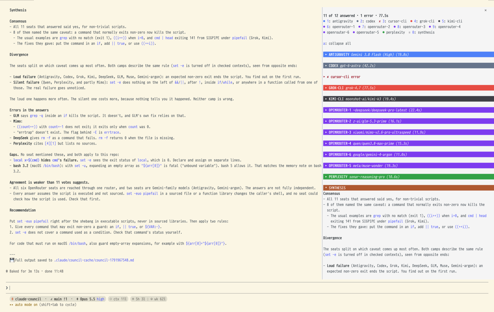

# claude-council

A Claude Code plugin that consults multiple AI coding agents in parallel and shows you their answers side-by-side. Useful when one model's bias could mislead you and the right call depends on cross-checking: architecture decisions, debugging dead ends, security reviews, framework picks.



Twelve seats answering one question in the pane inside Claude Code. Each banner
names the seat, the model that answered and how long it took, and the answers
fold once the synthesis lands so it sits near the top. This pane needs
`CLAUDE_CODE_ENABLE_FUNCTION_HOOKS=1`. Inside tmux without it, the answers
stream into a [tmux side pane](docs/REFERENCE.md#display--terminal-integration);
outside both, they arrive in the chat.

[Quick start](#quick-start) · [What gets sent](#what-gets-sent-and-saved) · [Commands](#everyday-commands) · [Providers](#choose-your-providers) · [Usage guide](docs/USAGE.md) · [Reference](docs/REFERENCE.md)

## Quick start

You need `curl` and `jq`, on macOS, Linux, or Windows through Git Bash.

1. Install the plugin in Claude Code:

   ```
   /plugin marketplace add hex/claude-marketplace
   /plugin install claude-council
   ```

2. Give it at least one provider, in the shell you start Claude Code from:

   ```bash
   export OPENAI_API_KEY="..."   # or GEMINI_API_KEY, XAI_API_KEY, PERPLEXITY_API_KEY,
                                 # KIMI_API_KEY, OPENROUTER_API_KEY
   ```

   Or install any of the `codex`, `agy` (Antigravity), `grok`, `kimi` or
   `cursor-agent` CLIs. They use your existing subscription and need no key. A
   local `ollama` model works too, with no key and no network. With none of
   these, `--local` convenes a council of Claude subagents instead
   ([Local council](docs/USAGE.md#local-council---local)).

3. Check what it found, then ask:

   ```
   /claude-council:status
   /claude-council:ask "Should I use UUID or BIGINT primary keys for a SaaS users table?"
   ```

Each provider answers on its own, then Claude writes a synthesis: where they
agree, where they split, and what to do. Agreement is not verification. Every
provider gets the same description of a system none of them can inspect, so
when they all agree the synthesis names the premise the answer rests on:

```
## Synthesis
All five recommend SQLite. Read that as agreement about the reasoning, not
as verification: every provider was given the same description of a system
none of them can inspect. The answer assumes this stays single-node — the
one premise that would flip it, and the one nobody here could check.
```

## What gets sent and saved

Read this before the first question about your code.

- **Your question goes to every selected provider.** A CLI seat sends it to
  that CLI's vendor, an API seat to that vendor's API. `openrouter` sends it to
  OpenRouter and on to whichever upstream serves the model. `ollama` keeps it
  on the machine.
- **Relevant files go with it.** The council picks up to 5 files that match
  your question (about 10,000 tokens) and lists them before sending.
  `--no-auto-context` turns that off, and `--file=` replaces the pick with
  your own file. An `--image=` goes to the providers that can read it.
- **The council saves everything in plaintext.** It writes the full prompt,
  attached files included, and every answer under `.claude/council-cache/`. The
  directory carries its own `.gitignore`, so nothing gets committed. Image
  bytes are never saved.
- **Each provider gets only its own vendor's environment variables.** Another
  vendor's key, or any other secret your shell exports, does not reach it
  ([Provider environment](docs/REFERENCE.md#provider-environment)).
- **`/claude-council:advise` sends part of this conversation.** It shows the
  size, the turn count and the opening lines, and asks before anything leaves.

## Everyday commands

```
/claude-council:ask "How should I structure authentication in this Express app?"
/claude-council:ask --providers=gemini,codex "What's the best approach for caching here?"
/claude-council:ask --file=src/auth.ts "What's wrong with this implementation?"
/claude-council:ask --image=shot.png "Why does this dialog render off-center?"
/claude-council:ask --roles=balanced "Review this implementation"
/claude-council:ask --debate "How should I structure the database schema?"
/claude-council:ask --quiet "Should I use Redis or Memcached?"
/claude-council:ask --output=docs/decision.md "Should we use REST or GraphQL?"
/claude-council:ask --async "Compare migration strategies for this schema"
/claude-council:result <job-id>
/claude-council:advise "are we solving the right problem here?"
/claude-council:status
```

Naming a provider in plain words works too: "check with grok" runs the council
with that provider alone. [Flags](docs/REFERENCE.md#flags) lists every flag,
and the [usage guide](docs/USAGE.md) explains each workflow.

## Choose your providers

- **Discovery.** Every provider with a key set, a CLI on `PATH` or a running
  `ollama` joins by default. `/claude-council:status` shows which ones did.
- **CLIs come first.** `codex` stands in for `openai`, `antigravity` for
  `gemini`, `grok-cli` for `grok` and `kimi-cli` for `kimi`. When a CLI fails
  and you have its API key, the API answers in its place and the header says so.
- **Pin a standing roster** when discovery finds too many:

  ```bash
  export COUNCIL_PROVIDERS="codex,antigravity"
  ```

  `--providers=` still overrides it for one call.
- **OpenRouter** seats any model it routes, Claude by default.
  `OPENROUTER_MODELS="a/b,c/d"` gives each entry its own seat (`openrouter-1`,
  `openrouter-2`).
- **`claude-cli`** seats Claude Code itself on your subscription, without your
  `CLAUDE.md`, settings or plugins. It joins only when you name it.
- **`copilot-cli`** seats the GitHub Copilot CLI on your Copilot plan, without
  your `AGENTS.md` or any tools. It joins only when you name it.

Keys, CLI details, default models and their fallbacks are in the
[reference](docs/REFERENCE.md#api-keys).

## The pane

Inside tmux, a side pane streams each answer as it lands, with live status per
provider, and offers to retry the ones that failed. Esc closes it.
`--no-pane` or `COUNCIL_NO_PANE=1` turns it off.

With `CLAUDE_CODE_ENABLE_FUNCTION_HOOKS=1`, the plugin's mod draws the pane
inside Claude Code instead, as in the screenshot above; inside tmux it asks
once which one you want. There you can cancel a
slow seat, fold sections and reopen the last run with `/council-pane`. Mods are
early access; the [mod README](mods/council-pane/README.md) has the keys,
settings and limits. The mod also lets Claude call the council as a tool, and
every call asks you first.

## More

| You want | Read |
|---|---|
| Roles, debate, agent mode, local council | [Usage guide](docs/USAGE.md) |
| Background jobs, export, quiet mode | [Usage guide](docs/USAGE.md#background-jobs---async) |
| A second model reviewing your diff before Claude stops | [Stop-gate review](docs/USAGE.md#stop-gate-review-opt-in-off-by-default) |
| Hand a coding task to a Codex agent on its own branch | [Specialists](docs/USAGE.md#specialists-experimental) |
| Every flag, variable, default and limit | [Reference](docs/REFERENCE.md) |
| Running the scripts without Claude Code | [Direct script usage](docs/REFERENCE.md#direct-script-usage) |
| How it works inside | [Architecture](docs/ARCHITECTURE.md) |
| Tests, releases, adding a provider | [TESTING.md](TESTING.md) |

## Troubleshooting

- **Cloned the repo and nothing loads.** Don't clone into `~/.claude/plugins/`,
  and `pluginDirectories` is not a real setting. See
  [Running from a local clone](docs/REFERENCE.md#running-from-a-local-clone).
- **No providers found.** Run `/claude-council:status`. Export keys in the
  shell you start Claude Code from. Or use `--local`.
- **A different model answered.** A header like `grok-4.6 (grok-latest
  unavailable)` is a [model fallback](docs/REFERENCE.md#model-fallback).
  Setting the provider's `_MODEL` variable turns it off.
- **No pane.** It needs tmux, or the variable above for the pane inside Claude
  Code.
- **Updating.** `/plugin update claude-council`, then restart Claude Code.
