# Reference

Every flag, provider, variable and default. The [README](../README.md) covers install and the first run; [USAGE.md](USAGE.md) covers the workflows.

## What gets sent and saved

Read this before the first question about your code.

- Your question goes to every selected provider. A command-line seat sends it
  to that tool's vendor; an API seat sends it to the vendor's API. OpenRouter sends it
  to OpenRouter and the upstream serving the model. Ollama keeps it on the
  machine when you use a local model.
- Relevant files go with it. The council picks up to five files that match
  your question, about 10,000 tokens, and lists them before sending.
  `--no-auto-context` turns that off. `--file=` replaces the selection with
  your own file. `--image=` goes only to providers that can read it.
- The council saves the full prompt, attached files, and every answer in
  plaintext under `.claude/council-cache/`. The directory has its own
  `.gitignore` to keep those files out of normal commits. It never saves
  image bytes there.
- Each provider receives its own vendor's variables. Other vendors' keys and
  unrelated shell secrets do not reach it. The
  [environment allowlist](#provider-environment) also covers process and
  transport variables.
- `/claude-council:advise` sends part of the conversation. It previews the
  size, turn count, and opening lines, and asks before sending.
- The heads-up side-check sends context mid-turn without asking once you
  enable it. The "Heads-up side-check" row in `/config` or the project's
  `.claude/council-heads-up.json` provides that consent. It sends the last
  five turns and the last eight tool results, capped at 2,000 characters per
  result, to one seat, codex by default. A Write or an Edit sends the text it
  wrote and the file path in place of its result, under the same cap. It sends
  no other tool input. A Bash result can contain a secret.
  The note shows the byte count and destination. Switch the row off or set
  `"enabled": false` in the project file to stop it. See the
  [heads-up guide](USAGE.md#heads-up-side-check-opt-in-off-by-default).

## Reading the synthesis

Providers answer independently. Claude then names where they agree, where
they split, and what to do. Agreement is not verification: the providers
share a description of a system they cannot inspect. When they all agree,
the synthesis names the premise that could change the answer.

For example:

```text
## 🧭 Synthesis
All five recommend SQLite. Read that as agreement about the reasoning, not
as verification: every provider got the same description of a system none
of them can inspect. The answer assumes this stays single-node. That is the
one premise that would flip it, and the one nobody here could check.
```

## Command examples

```text
/claude-council:ask "How should I structure authentication in this Express app?"
/claude-council:ask --providers=gemini,codex "What's the best approach for caching here?"
/claude-council:ask --file=src/auth.ts "What's wrong with this implementation?"
/claude-council:ask --image=shot.png "Why does this dialog render off-center?"
/claude-council:ask --roles=balanced "Review this implementation"
/claude-council:ask --debate "How should I structure the database schema?"
/claude-council:ask --quiet "Should I use Redis or Memcached?"
/claude-council:ask --output=docs/decision.md "Should we use REST or GraphQL?"
/claude-council:ask --async "Compare migration strategies for this schema"
/claude-council:result <job-id>
/claude-council:advise "are we solving the right problem here?"
/claude-council:status
```

Naming a provider in plain words works too: "check with grok" runs the council
with that provider alone. [Flags](#flags) lists every flag.
[USAGE.md](USAGE.md) explains each workflow.

## Choosing providers

Discovery includes providers with a configured key or a command-line tool on `PATH`,
including `ollama`. A local Ollama server must run to answer.
`/claude-council:status` shows what it found.

Command-line seats take precedence over their API siblings: `codex` replaces `openai`,
`antigravity` replaces `gemini`, `grok-cli` replaces `grok`, and `kimi-cli`
replaces `kimi`. If a command-line seat fails and its API key exists, the API answers in its
place. The answer's header records the fallback.

Pin a standing roster when discovery finds too many:

```bash
export COUNCIL_PROVIDERS="codex,antigravity"
```

`--providers=` overrides it for one call. See [roster rules](#pinning-a-standing-provider-roster).

OpenRouter can seat any model it routes, Claude by default.
`OPENROUTER_MODELS="a/b,c/d"` gives each entry its own seat, `openrouter-1`
and `openrouter-2`.

`claude-cli` uses Claude Code on your subscription without your `CLAUDE.md`,
settings, or plugins. `copilot-cli` uses GitHub Copilot's command-line tool on your
Copilot plan without your `AGENTS.md` or tools. `opencode` uses the OpenCode CLI
on whichever provider you logged it in to, without your config, plugins or MCP
servers, and with no tool it can use. All three join only when named.

See [API keys](#api-keys), [subscription providers](#cli-providers-subscription-auth-no-api-key),
[model defaults](#model-selection), and [fallback rules](#model-fallback).

## Requirements

- `curl` and `jq` for API calls
- Valid API keys for at least one provider, OR `codex` / `agy` (Antigravity) / `grok` / `kimi` / `cursor-agent` CLI installed, OR `ollama` running locally. `--local` needs none of these: it runs on Claude alone
- Optional: a Rich-capable Python (`python3` with a modern `rich`, or `uv`) upgrades the tmux pane's markdown rendering; without it the built-in perl renderer is used
- macOS, Linux, or Windows via Git Bash; the test suite runs on all three in CI

## Running from a local clone

For normal use, install from the marketplace, which persists across sessions. A manual clone is for running from a local working copy
(development, or offline). Clone the repo **anywhere**, then point Claude Code
at the repo root for the current session:

```bash
git clone https://github.com/hex/claude-council.git
claude --plugin-dir /path/to/claude-council    # repo root; loaded for this session only
```

> **Cloned it and nothing loads?** Two traps to avoid:
> 1. **Don't clone into `~/.claude/plugins/`** (Windows:
>    `%USERPROFILE%\.claude\plugins\`). That's Claude Code's managed install
>    *cache* — it is never scanned for manually-added plugins, so the plugin
>    won't appear in the Installed tab or respond to its slash commands.
> 2. **`pluginDirectories` in `settings.json` does nothing** — it isn't a real
>    setting, so it's silently ignored (no error shown). Use `--plugin-dir`
>    above for a local clone, or install from the marketplace for a
>    persistent setup.

## Flags

| Flag | Description |
|------|-------------|
| `--providers=list` | Query specific providers (e.g., `gemini,openai,codex`). Naming one in plain words works too: "check with grok" runs the council with that provider alone. There is no `--grok` style flag |
| `--roles=list` | Assign roles (e.g., `security,performance`, a preset like `balanced`, or `provider=role` pairs) |
| `--debate` | Enable two-round debate mode |
| `--file=path` | Include specific file in context |
| `--image=path` | Attach one image (e.g. a screenshot) for vision-capable providers |
| `--output=path` | Export response to markdown file |
| `--quiet` | Show only synthesis, hide individual responses |
| `--agents` | Agent-enhanced analysis, one Claude analyst per provider (slower, deeper) |
| `--local` | Local Claude-only council when you have no provider keys (see [USAGE.md](USAGE.md#local-council---local)) |
| `--async` | Detach the query as a background job; fetch with `/claude-council:result` |
| `--no-cache` | Force fresh queries, skip cache |
| `--no-auto-context` | Disable automatic file detection |
| `--no-pane` | Disable streaming tmux pane (default: on inside tmux) |
| `--verbosity=LEVEL` | Response style: `brief` / `standard` / `detailed` |

## API Keys

Set environment variables (recommended):

```bash
export GEMINI_API_KEY="your-key"
export OPENAI_API_KEY="your-key"
export XAI_API_KEY="your-key"          # GROK_API_KEY also accepted
export PERPLEXITY_API_KEY="your-key"
export KIMI_API_KEY="your-key"         # MOONSHOT_API_KEY is read as a fallback,
                                       # but only KIMI_API_KEY makes kimi discoverable
export OPENROUTER_API_KEY="your-key"   # one key, any model on openrouter.ai/models
```

Or store them in the plugin's config with `/plugin configure claude-council`, or
from a shell with `claude plugin configure claude-council@<marketplace> --values-stdin`.
The six fields are `gemini_api_key`, `openai_api_key`, `xai_api_key`,
`perplexity_api_key`, `kimi_api_key` and `openrouter_api_key`. Claude Code keeps
them in its secure storage, not in `settings.json`. On macOS that is the
Keychain. On Linux and Windows, and on a Mac whose Keychain refuses the write,
Claude Code falls back to a plaintext `.credentials.json` file in `~/.claude`,
readable only by your user, the same place it keeps its own
[login](https://code.claude.com/docs/en/authentication). When a session
starts, the council's mod sets each stored key as `GEMINI_API_KEY`,
`OPENAI_API_KEY`, `XAI_API_KEY`, `PERPLEXITY_API_KEY`, `KIMI_API_KEY` or
`OPENROUTER_API_KEY` in Claude Code's own process. Every command Claude Code
starts after that inherits it, the council's slash commands, tool calls,
heads-up checks and Stop-gate reviews among them. The mod writes no key to a
file. Saving in the `/plugin configure` dialog reloads the mod, which applies
the key at once. After `claude plugin configure` in a shell, restart Claude Code.

A stored key wins over the same variable exported in your shell, for every
command Claude Code starts, in every project. A per-project export of that
variable, such as one direnv loads, no longer reaches those commands while the
key is stored.

The mod only ever sets these variables. A key removed from the config, or the
plugin disabled, stays in that session's environment until Claude Code restarts, and
the shell export it replaced does not come back until then. Saving an empty
value does not remove a stored key.

Stored keys work only where the mod loads. It needs Claude Code 2.1.287 or
later, and it does not load under `--safe-mode`, with `disableAllHooks` set, or
where managed settings set `allowManagedHooksOnly` or `allowManagedModsOnly`.
The desktop app's plugin Settings tab shows the same fields and keeps what you
save on that computer, for sessions that run there and not for SSH, WSL or
cloud sessions. The
[platform-support page](https://claude.com/docs/plugins/platform-support) says
Cowork does not prompt for plugin values, so stored keys never reach claude.ai
chat or Cowork.

`openrouter` seats whatever model `OPENROUTER_MODEL` names, defaulting to
`anthropic/claude-fable-5.2` — the one vendor the council has no direct seat for.
To seat several routed models at once, list them instead:

```bash
export OPENROUTER_MODELS="deepseek/deepseek-v3.2,z-ai/glm-5.3,qwen/qwen3-max"
```

Or store the list in the plugin's config: the OpenRouter models field
(`openrouter_models`) in `/plugin configure claude-council`. Separate the ids
with commas or spaces. The list is not a secret, so Claude Code keeps it with
the plugin's other options in `settings.json`, not in secure storage. When a
session starts, the council's mod sets a non-blank value as
`OPENROUTER_MODELS` the way it sets a [stored key](#api-keys): it wins over a
shell export, a blank field leaves the export alone, and a list removed from
the config stays in the session until Claude Code restarts. It needs the mod,
as stored keys do.

Each entry becomes its own council member — `openrouter-1`, `openrouter-2`,
`openrouter-3` — with its own header, model label, cache entry and role, all
sharing the one key. `--providers=openrouter-2` picks one out. The list replaces
the single `openrouter` seat rather than adding to it, so the same model never
answers twice under two headers. Reordering the list reassigns the numbers, which
matters only if you pin roles positionally. A seat that should accept images opts
in by number (`OPENROUTER_2_VISION=1`): the roster can hold any model, and nothing
in the id says whether it reads images.
Two things follow from it being a router. Your prompt reaches OpenRouter and then
the upstream serving that id, so it is two disclosures rather than one. And
pointing it at a model another seat already runs (`OPENROUTER_MODEL=openai/gpt-5.6`
alongside `OPENAI_API_KEY`) gives you two headers voicing one model: the synthesis
is told to read that agreement as possible duplication, not corroboration.

`ollama` needs no key at all: install it, pull a model, and it joins the council
as a local provider.

## CLI Providers (subscription auth, no API key)

If the `codex`, `agy`, `grok`, `kimi`, or `cursor-agent` CLIs are installed and on `PATH`, they're discovered automatically, and the four with an API sibling are **preferred over it** by default:

- `codex` (OpenAI Codex CLI) shadows the `openai` API provider — uses your `~/.codex/config.toml` model unless `CODEX_MODEL` is set
- `antigravity` (Antigravity CLI, `agy`) shadows the `gemini` API provider — uses the model selected in the Antigravity app unless `ANTIGRAVITY_MODEL` is set
- `grok-cli` (xAI Grok CLI, `grok`) shadows the `grok` API provider — uses the grok CLI's own default model unless `GROK_CLI_MODEL` is set
- `kimi-cli` (Kimi Code CLI, `kimi`) shadows the `kimi` API provider, using the kimi CLI's own configured model unless `KIMI_CLI_MODEL` is set
- `cursor-cli` (Cursor CLI, `cursor-agent`) has no API sibling; it uses the model picked in the CLI unless `CURSOR_CLI_MODEL` is set. A free Cursor plan runs `auto` only and rejects any named model. Discovery keys on `cursor-agent`, not the `agent` name the installer also links, because the grok CLI ships an `agent` too

`ollama` is also discovered from `PATH`, but it is local and keyless rather than subscription-backed, so it shadows nothing and has no API sibling.

**Claude CLI seat (`claude-cli`), opt-in.** Claude Code itself can sit on the council, on the Claude subscription you are already logged in with. Discovery never seats it, since every user of this plugin has `claude` on `PATH`; name it with `--providers=...,claude-cli` or in `COUNCIL_PROVIDERS`. It runs `claude -p --safe-mode --setting-sources "" --tools "" --no-session-persistence`, so it gets the same prompt as every other seat and none of your setup: no CLAUDE.md, settings, plugins, hooks (this plugin's Stop gate included), MCP servers or tools, and nothing lands in your session history. It uses the account's default model unless `CLAUDE_CLI_MODEL` is set, and has no API sibling to fall back to. Things to know before seating it:

- It draws on the same subscription limits as the session you are driving it from, and `--debate` makes two calls per question.
- It authenticates with your claude.ai login, or `CLAUDE_CODE_OAUTH_TOKEN` and `CLAUDE_CONFIG_DIR` when set. `ANTHROPIC_API_KEY` is never passed to it, so it never bills the API.
- If your Claude Code reaches Claude through Bedrock, Vertex or a gateway instead, the seat loses those settings to the same scrub. Name the variables it needs in `COUNCIL_PASS_ENV`, for example `COUNCIL_PASS_ENV=CLAUDE_CODE_USE_BEDROCK,AWS_REGION,AWS_PROFILE`.
- On a Team or Enterprise account it is not fully blind: your organisation's server-side instructions and managed policy settings still reach it, the same ones the driving session gets. No CLI flag removes them.
- Claude writes the synthesis too, so it counts this seat's agreement as one voice, not independent support.

**Copilot CLI seat (`copilot-cli`), opt-in.** The GitHub Copilot CLI can sit on the council, on your Copilot plan, through the login the CLI already has. Discovery never seats it, because each question spends one of the plan's premium requests; name it with `--providers=...,copilot-cli` or in `COUNCIL_PROVIDERS`. It runs `copilot --output-format json --no-auto-update --no-custom-instructions --disable-builtin-mcps --available-tools=none` with the prompt on stdin. The model gets no tools, built-in or MCP, and no `AGENTS.md` or other instruction files. The GitHub MCP server never connects, and the CLI never downloads an update during a seat run. It has no API sibling to fall back to. Things to know before seating it:

- Two things reach it that no flag removes. MCP servers in your `~/.copilot/mcp-config.json` still start, though the model gets none of their tools. The CLI also saves each run in your Copilot session history.
- It authenticates with `COPILOT_GITHUB_TOKEN` when set, else your stored login from `copilot login` or the GitHub CLI's `gh auth login`. Copilot reads the second by running `gh`, so `gh` must stay on `PATH`. The council passes `COPILOT_GITHUB_TOKEN`, `COPILOT_HOME`, `COPILOT_CLI_*`, and `GH_CONFIG_DIR`, `GH_HOST` and `COPILOT_GH_HOST` for a relocated or GitHub Enterprise `gh` login, and nothing else of yours: `GH_TOKEN` and `GITHUB_TOKEN` stay behind, so a token your shell exports for `gh` or `git` does not choose the account, and so does `COPILOT_ALLOW_ALL`, which would make the CLI load the working directory's hooks.
- With `COPILOT_CLI_MODEL` unset, the CLI picks the model per question, and two questions can get different models. The header shows `default`, not the model that answered. A named model can fail. On one plan, `--model` rejected every name tried, including a model the automatic pick had just used, and the seat reports the CLI's `is not available` error. A model saved with `copilot config model` did not change the pick in a seat run, so the council does not read it.
- `/claude-council:status` shows whether `copilot` is on `PATH`, not whether it has a login. The CLI has no status command, and a test prompt would spend a premium request. A seat without a login fails with the CLI's `No authentication information found` and the ways to log in.
- The automatic pick can be a Claude model, so the synthesis counts this seat's agreement the way it counts a router seat's.

**OpenCode seat (`opencode`), opt-in.** The OpenCode CLI can sit on the council, on whichever provider you logged it in to with `opencode auth login`. Discovery never seats it, because each question bills that provider; name it with `--providers=...,opencode` or in `COUNCIL_PROVIDERS`. It runs `opencode run --standalone --format json` with the prompt on stdin, and passes `-m` with the model from `OPENCODE_MODEL`, or else with the `model` from your own OpenCode config. `--standalone` gives each run a private server, so the run never reaches your background OpenCode service, which keeps the environment and config it started with. The seat points `OPENCODE_CONFIG_DIR` at an empty directory and unsets `OPENCODE_CONFIG`, so none of your global config, plugins, MCP servers, agents or commands load. It sets `OPENCODE_CONFIG_PROJECT_DISABLE=1`, the name the CLI reads, and `OPENCODE_DISABLE_PROJECT_CONFIG=1`, the name its docs give, so no `opencode.json` or `AGENTS.md` from the working directory reaches it. It also sets an inline config that denies every permission but `read`, which it sets to ask, so the model gets no tool it can use. OpenCode's free models refuse a request without the read tool, reporting `Free usage limit reached`, so `read` stays in the request. The seat denies a read outside its empty working directory, and one inside it asks, which a headless run can't do, so the read fails and the model answers without one. The seat refuses to start when `TMPDIR` sits inside a git repository, where OpenCode would take the whole repository as the seat's project and a read permission you saved for it would apply. A model that asks for a denied tool fails, and the seat reports the provider's error, such as Gemini's `UNEXPECTED_TOOL_CALL`. It has no API sibling to fall back to. Things to know before seating it:

- The CLI saves every run in its session history (`~/.local/share/opencode/opencode.db`), and no flag stops that, which is a difference from `claude-cli`'s `--no-session-persistence`. The seat deletes its own session after each run with `opencode session delete --standalone`. The delete can fail, or the council can stop the seat before it runs, and that run then stays in your history.
- It authenticates with the logins `opencode auth login` stores under `XDG_DATA_HOME/opencode`. The council passes `OPENCODE_MODEL`, `OPENCODE_CONFIG`, `OPENCODE_CONFIG_DIR` and `XDG_*`, and no vendor key: `ANTHROPIC_API_KEY`, `OPENAI_API_KEY`, `GEMINI_API_KEY` and the rest stay behind, as `ANTHROPIC_API_KEY` does for `claude-cli`. Every other `OPENCODE_*` variable stays behind too, because the seat sets its own config and an inherited one, such as `OPENCODE_CONFIG_CONTENT` or `OPENCODE_CONFIG_PROJECT_DISABLE`, would let your setup back in. If your OpenCode authenticates through a key in your environment, name it in `COUNCIL_PASS_ENV`, for example `COUNCIL_PASS_ENV=GEMINI_API_KEY`.
- With `OPENCODE_MODEL` unset, the seat uses the `model` from your `opencode.json`, read where the CLI reads it: an `OPENCODE_CONFIG` file first, then `opencode.json` or `opencode.jsonc` in `OPENCODE_CONFIG_DIR`, or in `$XDG_CONFIG_HOME/opencode` (`~/.config/opencode` by default). A `.jsonc` file with comments reads as unset. `OPENCODE_MODEL` (`provider/model`, for example `google/gemini-2.5-flash-lite`) overrides it. With neither, the CLI uses its built-in default and the header shows `default`. On a fresh install that default is an OpenCode free model, which can run out, and the seat then fails with `Free usage limit reached`. The CLI also falls back to that default, with no error, for a model id it does not recognise.
- `/claude-council:status` lists the stored logins with `opencode auth list --standalone` under the seat's own environment, and sends no prompt. With no login it reads not authenticated, with `opencode auth login` as the fix. It does not check that a stored login still works or that it belongs to the provider `OPENCODE_MODEL` names: an expired OAuth login reads Connected, and the seat then fails with the provider's error, for example `OAuth access token is invalid`.
- The model can be any vendor's, Claude included, so the synthesis counts this seat's agreement the way it counts a router seat's.

CLI providers use your existing CLI subscription and need no API key. None of them meters a call except `copilot-cli`, where each question spends one of the plan's premium requests, and `opencode`, which bills the provider you logged it in to. To opt back into the API variant for a single call, pass it explicitly: `--providers=openai`, `--providers=gemini`, `--providers=grok`, or `--providers=kimi`. Listing both API and CLI together (e.g., `--providers=grok,grok-cli`) runs them side-by-side for comparison.

If a CLI provider fails at query time and its API sibling's key is set, the council automatically retries through that API sibling and marks the slot as a fallback: the answer is shown under the CLI slot with the API model's name, a "fell back to … API" note, and the CLI's own error as the reason; the pane row reads `fallback` with `<model> via <sibling> API`. The fallback is skipped when the sibling is already in your selected providers, so you never get the same vendor's answer twice.

**Grok CLI guards, and Docker Desktop.** `grok-cli.sh` runs grok with two guards: `--deny '*' --no-subagents`, which refuses every tool call at grok's permission layer (without it grok's file and shell tools run on your machine; `--tools ''` and `--permission-mode plan` do not stop them), and `--sandbox read-only`, grok's own OS profile on top. grok 1.0.46 refuses to start any sandbox profile when `/var/run/docker.sock` is a symlink, which Docker Desktop on macOS creates when "Allow the default Docker socket to be used" is on. When grok refuses to start because it cannot apply the sandbox (`could not apply the 'read-only' sandbox profile … Refusing to start`, as it does on that symlink), the provider runs once more on the deny rules alone, so the seat keeps answering; any other failure falls back to the `grok` API as usual. `/claude-council:status` probes grok-cli with `grok models`, which does not exercise the sandbox, so it reads Connected either way. To get the OS sandbox back, turn that Docker Desktop setting off (the `docker` CLI keeps working through `~/.docker/run/docker.sock`), or wait for a grok release that resolves the symlink. The seat also runs with `GROK_{CLAUDE,CURSOR}_{SKILLS,RULES,AGENTS,MCPS,HOOKS,SESSIONS}_ENABLED=0`: grok otherwise imports your Claude Code and Cursor hooks, rules, skills, agents, MCP servers and sessions, so your SessionStart and Stop hooks would run inside every council seat and your CLAUDE.md would shape its answer. grok's own `~/.grok` configuration still applies.

Override CLI model selection. Left unset, the council reads what each CLI has
selected — `~/.codex/config.toml` (or `$CODEX_HOME`), `~/.grok/config.toml`,
`~/.kimi-code/config.toml`, and agy's own settings — and names that model in
the response banner, so you can see which model answered without pinning one:

```bash
export CODEX_MODEL="gpt-5-codex"                # default: the codex CLI's own configured model
export ANTIGRAVITY_MODEL="Gemini 3.1 Pro (High)"  # default: the model selected in the Antigravity app
export GROK_CLI_MODEL="grok-4.3"                # default: the grok CLI's own default model
export KIMI_CLI_MODEL="kimi-k3"                 # default: the kimi CLI's own configured model
export CURSOR_CLI_MODEL="composer-2.5"          # default: the model picked in the Cursor CLI (paid plans only)
export CLAUDE_CLI_MODEL="fable"                 # default: the account's default model (settings.json is not read)
export COPILOT_CLI_MODEL="claude-sonnet-5.5"    # default: the CLI's automatic pick per question (settings.json is not read)
export OPENCODE_MODEL="google/gemini-2.5-flash-lite"  # default: the model in your opencode.json, else the CLI's built-in default
```

The Antigravity CLI cannot take its prompt on stdin — `--print` with no value
prints the help — so the prompt is the value of `-p` and rides the command line.
Windows caps that at 32k, which a `--file`-sized prompt would exceed
(CreateProcess fails with error 206), so past `COUNCIL_ARGV_LIMIT` (default
24000 chars) the prompt is written to a file and agy is told to read it. The
file gets a directory of its own, which is the only thing `--add-dir` opens to
the sandboxed agent, and it is removed when the run ends.

## Pinning a standing provider roster

Discovery enlists everything it finds, which is rarely what you want once more
than a couple of agents are installed. `COUNCIL_PROVIDERS` pins the default set;
an explicit `--providers` still overrides it per call.

```bash
export COUNCIL_PROVIDERS="codex,antigravity"  # queried by default, nothing else
```

`--list-default` and `--list-available` both report the pinned roster, so neither
tooling nor the human-readable view disagrees with what a query would actually
run. Spaces around the commas are fine, in the variable and in `--providers`
alike.

The Kimi CLI runs every prompt under an agent definition that grants it no tools
(`prompts/kimi-cli-agent.md`). Its print mode auto-approves tool calls, so the
council denies them outright rather than letting a prompt drive file writes or
shell commands. The Cursor CLI runs in `--mode ask`, its read-only mode, and is
never passed `--force`; its print mode otherwise has every tool, shell included.

## Model Selection

Override default models via environment variables:

```bash
export GEMINI_MODEL="gemini-flash-latest"           # default (tracks Google's current Flash)
export OPENAI_MODEL="gpt-6-astra"                   # default
export GROK_MODEL="grok-latest"                     # default (tracks xAI's current flagship)
export PERPLEXITY_MODEL="low"                       # default (Agent API preset, reasoning + search)
export KIMI_MODEL="kimi-k3"                         # default (reads images)
export KIMI_VISION=1                                # only needed when KIMI_MODEL
                                                    # names an image-capable model
                                                    # other than the default
export COUNCIL_AGENT_MODEL="sonnet"                 # default: the model the --agents
                                                    # ANALYSTS run on (sonnet/opus/haiku/fable).
                                                    # Not a provider model — see below.
export OPENROUTER_MODEL="anthropic/claude-fable-5.2"  # default (single seat)
export OPENROUTER_MODELS="a/b,c/d,e/f"              # or: one seat per entry
export OPENROUTER_2_MODEL="c/d-pinned"              # overrides roster seat 2's entry;
                                                    # what the exit-3 degrade path sets
export OPENROUTER_REASONING_TOKENS=8000             # thinking budget per request (default 8000; 0 lets the model decide)
export OPENROUTER_VISION=1                          # only needed when OPENROUTER_MODEL
                                                    # names a model that accepts images
export OPENROUTER_2_VISION=1                        # same, for roster seat 2
export OLLAMA_MODEL="llama3.2"                      # default: whichever model `ollama list` shows first
export OLLAMA_HOST="http://localhost:11434"         # default
export GEMINI_THINKING_BUDGET=8192                  # optional: cap Gemini's internal reasoning tokens (unset: the model decides)
```

`COUNCIL_AGENT_MODEL` is the odd one out: every other variable here names a model
that *answers* the question, while this one names the Claude analyst that wraps a
provider in `--agents` mode — it runs the query, judges the reply and returns a
structured analysis. It is pinned rather than inherited from your session, so the
cost of a mode that already spawns one agent per provider does not swing by a
factor of several depending on which model you happen to be running. One measured
run of eight seats came to ~456k analyst tokens.

Gemini and Grok default to their vendor's rolling alias, so the council follows
a new flagship without a release. Pin an explicit id when you need a fixed model
across runs: cached answers key on the id, so an alias can serve an answer the
model behind it no longer gives, and the response header names the alias rather
than the model that answered.

Response length cap (default: 2048; `ollama` uses 4096, since local reasoning
models spend much of the budget on thinking that never reaches the answer):

```bash
export COUNCIL_MAX_TOKENS=4096  # longer responses
export COUNCIL_MAX_TOKENS=1024  # shorter, faster responses
```

## Model fallback

If a provider's default model is unavailable for your API key or region, the
council answers with a verified fallback model instead of failing, and says so
in the response header:

```
## ● Grok - grok-4.7 (grok-latest unavailable)
```

| Provider | Default | Fallback |
|---|---|---|
| openai | `gpt-6-astra` | `gpt-6.1-sol` |
| grok | `grok-latest` | `grok-4.7` |
| gemini | `gemini-flash-latest` | `gemini-3.8-flash` |
| perplexity | `low` | `fast` |
| kimi | `kimi-k3` | `kimi-k2.6` |
| ollama | first local model (`OLLAMA_MODEL` to pin) | — |
| openrouter | `anthropic/claude-fable-5.2` | `anthropic/claude-opus-5.5` |

The same substitution is also noted on stderr and folded into the synthesis,
so it's visible even in quiet mode or a headless run. Setting `<PROVIDER>_MODEL`
explicitly disables the fallback for that provider — an explicit choice is
respected verbatim.

The verdict — "this model is unavailable for this key" — is cached for a day
so it isn't retried on every query, and the council returns to the default
automatically once it becomes available. This is a separate cache from the
[response cache](#response-caching) (`COUNCIL_CACHE_DIR` / `COUNCIL_CACHE_TTL`): it tracks
per-model availability, not full answers. Tune it with `COUNCIL_AVAILABILITY_TTL`
(seconds, default `86400`); set it to `0` to re-check on every query. It is
independent of `--no-cache`, which only forces fresh *answers*.

## Reasoning Models

For reasoning models from any provider, the token limit is automatically increased to 8x the base value (minimum 32768). This is because reasoning models combine internal thinking tokens and visible output tokens into a single `max_output_tokens` limit — without the bump, the model can run out mid-response.

The bump applies to:

- **OpenAI**: `codex-*`, `*-codex`, `o3-*`, `o4-*`, `gpt-5.[4-9]*`, `gpt-[6-9]*`
- **Gemini**: `gemini-3*`, `*thinking*`, `gemini-*-latest`
- **Grok**: `*reasoning*`, `grok-4*`, `grok-3-mini-*`, `grok-build-*`, `grok-latest`
- **Perplexity**: the `low`, `medium`, `high` and `xhigh` presets
- **Kimi**: `kimi-k*` (so the default model always triggers the bump)
- **OpenRouter**: every routed model. The seat can be pointed at any id, and a
  pattern list misses reasoning models whose names carry no tell
  (`z-ai/glm-5.3-flash`, `xiaomi/mimo-v2.5`), which then spend the whole base
  thinking and answer with nothing. `max_tokens` is a ceiling, not a spend, and
  OpenRouter clamps a value above an upstream's own limit rather than rejecting
  it, so the bump is free
- **Ollama**: `*r1*`, `*reason*`, `*gpt-oss*`, `qwen*`, `gemma*`, `deepseek*`

The OpenRouter seat also sends a thinking budget, `reasoning.max_tokens`, on
every request (default 8000; `OPENROUTER_REASONING_TOKENS` overrides it, `0`
sends none). The two caps do different jobs. `max_tokens` bounds thinking and
answer together, so a model can spend the whole cap thinking and answer with
nothing. The budget bounds the thinking alone, leaving room for the answer: a
routed model that would otherwise think for twenty thousand tokens on a long
prompt, and outlast `COUNCIL_TIMEOUT`, answers inside two minutes. Upstreams
without direct allocation map the number to an effort level, and adaptive
models ignore it.

| Model Type | COUNCIL_MAX_TOKENS | Actual Limit |
|------------|-------------------|--------------|
| Standard (gpt-5.1) | 2048 (default) | 2048 |
| Reasoning (gpt-6-astra) | 2048 (default) | 32768 |
| Reasoning (gpt-6-astra) | 4096 | 32768 |

Control reasoning effort to balance speed vs thoroughness:

```bash
export OPENAI_REASONING_EFFORT="low"     # faster, less reasoning overhead
export OPENAI_REASONING_EFFORT="medium"  # default - balanced
export OPENAI_REASONING_EFFORT="high"    # thorough reasoning, slower
```

Grok's token accounting depends on the model: `grok-build` counts thinking tokens separately, so `max_tokens` caps only its visible output; the other reasoning models (`grok-4*`, `*-reasoning`, `grok-3-mini-*`) share one budget between thinking and output. Either way, council bumps the cap for these models so a long answer isn't cut off mid-response.

## Perplexity Search Features

The Perplexity seat uses the Agent API (`/v1/agent`) with its `web_search` tool, so answers are web-grounded with inline citations. Sonar Chat Completions ended on 2026-09-27. The seat refuses an old `sonar-*` model id before any request and names the preset to use instead.

```bash
# Filter search results by recency: day, week, month, year
export PERPLEXITY_RECENCY="week"
```

`PERPLEXITY_MODEL` takes an Agent API preset or a `provider/model` id:
- `fast` - quick search answers (Perplexity's replacement for `sonar` and `sonar-pro`)
- `low` - reasoning + search (replaces `sonar-reasoning-pro`, default)
- `medium`, `high`, `xhigh` - deeper research, slower and costlier (`high` replaces `sonar-deep-research`)
- a `provider/model` id such as `perplexity/sonar`, sent as `model` with web search still on

The reasoning presets spend their thinking from the `max_output_tokens` budget. An answer cut off at that budget still prints, under a warning that names the reason. A reply with neither an answer nor an error message, such as HTML from a proxy, is an error that prints the raw body.

Perplexity is useful when you need current information (latest framework versions, recent best practices) rather than just training-data knowledge.

## Response Caching

Responses are automatically cached to speed up repeated queries and save API costs:

```bash
# Uses cache if available (default)
/claude-council:ask "What's the best testing framework?"

# Force fresh queries, skip cache
/claude-council:ask --no-cache "What's the best testing framework?"
```

Cache configuration:
```bash
export COUNCIL_CACHE_DIR=".claude/council-cache"  # Cache location (default)
export COUNCIL_CACHE_TTL=3600                      # Cache lifetime in seconds (default: 1 hour)
```

Cached responses show `cached` instead of `success` in the status output. Cache is keyed by provider, model, verbosity, the `COUNCIL_MAX_TOKENS` cap, the attached image and the prompt, which carries the role, so:
- Changing models invalidates the cache
- Using `--roles` creates separate cache entries (same prompt with different role = cache miss)
- Debate mode round 2 rebuttals are not cached (they depend on round 1 content) — with one exception: if a CLI provider fails in round 2 and falls back to its API sibling, that fallback rebuttal is cached, keyed on the full debate prompt (which already includes the round 1 answers)

Privacy: cache entries and the saved `council-*.md` transcripts store the **full prompt in cleartext** — including any files you pass with `--file` and the auto-included context. Council drops a `.gitignore` (`*`) into the cache dir so these never get committed, but the plaintext still lives on local disk under `COUNCIL_CACHE_DIR`. The first cached run after an entry passes `COUNCIL_CACHE_TTL` deletes it; a transcript stays until you delete it.

## Retry & Timeout

Automatic retry on transient failures (429 rate limits, 5xx server errors):

```bash
export COUNCIL_MAX_RETRIES=3    # default: 3 retries
export COUNCIL_RETRY_DELAY=1    # default: 1 second initial delay (doubles each retry)
export COUNCIL_TIMEOUT=300      # default: 300 seconds per API request
export COUNCIL_CLI_TIMEOUT=1200 # default: 1200 seconds per CLI-provider run
```

Timeouts fail fast (no retry) to prevent blocking on hung providers.

Retries apply to the API providers, whose requests go through `curl`; a
transient 429 or 5xx is worth another attempt. The CLI providers get a single
attempt, because a CLI that is merely slow is not a transient failure and
retrying it multiplies the wait. That is why their default bound is higher: an
API provider may spend up to `(COUNCIL_MAX_RETRIES + 1) × COUNCIL_TIMEOUT`,
so one shared number would give a CLI a deadline four times stricter. Setting
`COUNCIL_TIMEOUT` explicitly overrides both.

CLI providers reading a large `--file` are the ones that hit this — a 64KB
payload has taken kimi past fifteen minutes.

## Provider environment

Each provider runs with only the environment it needs: the basics (`PATH`,
`HOME`, `USER`, `TMPDIR`, `TERM`, `LANG`, `LC_*`, `XDG_*` and a few more),
proxy and CA-bundle settings, the Windows variables Git Bash needs, every
`COUNCIL_*` setting, and its own vendor's variables (`GEMINI_*` and
`GOOGLE_*` for Gemini and Antigravity, `XAI_*` and `GROK_*` for Grok, and so
on). Another vendor's key, and any other secret your shell exports, does not
reach it. Nor do the `CLAUDE_PLUGIN_OPTION_*` variables Claude Code gives a
hook, which hold every stored plugin option, the API keys among them, unless
`COUNCIL_PASS_ENV` names one.
If a CLI provider needs something else from your environment, name
it:

```bash
export COUNCIL_PASS_ENV=NODE_OPTIONS,EXAMPLE_VAR   # comma-separated names passed to every provider
```

The heads-up side-check ([usage](USAGE.md#heads-up-side-check-opt-in-off-by-default))
reads three more, all optional:

```bash
export COUNCIL_HEADS_UP_SEAT_SECONDS=60   # the seat's deadline per check
export COUNCIL_HEADS_UP_TURNS=5           # transcript window, in turns
export COUNCIL_HEADS_UP_RESULTS=8         # tool results in the digest, 2,000 characters each
```

## Display & Terminal Integration

When run inside tmux, council opens a streaming side pane that shows live provider status (`querying`, `complete`, `fallback`, `cached`, `error`, `cancelled` with timing) and renders each response as it lands. Rendering prefers [Rich](https://github.com/Textualize/rich) when a Rich-capable Python is available (`python3` with a modern `rich` installed, or [`uv`](https://docs.astral.sh/uv/), which fetches it on demand): word-wrapped prose, tables fitted to the pane width, syntax-highlighted code, clickable links — styled with your terminal's own palette (cyan headings, yellow code, vendor-colored banners). Without one, a built-in dependency-free perl markdown renderer takes over with the same visual language, so nothing needs to be installed. Press **Esc** or **Ctrl-D** to close the pane.



Two subscription seats, two API seats, and a fake Kimi failure in the tmux pane,
zoomed to 110 columns. Each answer's banner names the model and elapsed time.

A provider that fails shows its error text under a `✗ <provider> error` heading. A CLI seat whose API sibling answered shows an amber `↪ <provider> fell back` notice with the reason (the CLI's error text, or that the image went to a vision model), then the answer; it does not count as failed for the retry offer. When any provider has failed, the pane then offers `[r] retry failed (<providers>) · [esc/ctrl-d] close` with a countdown: **r** re-queries only the failed providers inside the same run, so a recovered answer reaches the synthesis, the saved transcript and the cache like any other; **Esc** closes the pane and the run carries on with what it has. The offer stays open for `COUNCIL_RETRY_WAIT` seconds (default 45; `0` disables it) and is made once per run. The run waits while the offer is open, so a retry extends the council's wall time by another provider round. `--async` jobs default to `0`: nobody is committed to answering a detached run's pane, so it never waits.

A seat that is taking too long can be cancelled from the Claude Code pane, or every seat still out at once from its band (the [mod README](../mods/council-pane/README.md) has the keys): the run ends that seat's process tree, the row's bar turns to a bare grey track, the summary counts it apart from the errors, and the retry offer does not name it. In the result JSON and the formatted output the seat is an error whose text reads `cancelled from the pane`, so the synthesis leaves it out like any seat without an answer; a seat cancelled in round 1 sits out the debate round and gets no rebuttal block. A press that lands after the seat has answered keeps the answer, and a seat that traps the signal is killed five seconds on. Only round 1 can be cancelled: the debate round draws no rows. The tmux pane shows a cancelled seat but has no key to cancel one.

Resizing the window reflows the pane. Wrap width is chosen when a response is rendered, so answers that landed at different widths would otherwise sit side by side at different widths; once the new width has held still for about half a second, every answer so far is re-rendered to it, at the close prompt as well as mid-run. The wait is deliberate: dragging a pane border reports a stream of intermediate widths, and re-rendering each one would cost a second of work and your scrollback every time. The redraw clears the pane's scrollback along with the screen, which resets copy-mode position.

Colors adapt to your terminal theme: the pane detects the background
(OSC 11 query, `COLORFGBG` fallback). The Rich renderer flips its
code-highlighting theme to match; the perl renderer renders bold/italic
emphasis bright on dark themes, dark on light themes, and attribute-only when
undetectable, with muted text (link URLs, table grid lines, `---` rules,
sub-headings, the "waiting on" label) following suit — faint/bright-black on
dark, a readable dark gray on light.
Force it with `COUNCIL_THEME=light` or `COUNCIL_THEME=dark`.

When the outer terminal is iTerm2, council also drives:

- **Tab color** — yellow while querying, green on success, red if any provider errored. Set via `it2setcolor`; ambient state signal without looking at the terminal.
- **Dock attention** — bounces the iTerm2 dock icon when council finishes if the run took longer than `COUNCIL_ATTENTION_THRESHOLD` (default 2000ms). Useful for slow `--debate` queries when you've switched apps.
- **`SetMark` navigation** — emits OSC 1337 SetMark before each provider response inside the pane. Cmd+Shift+↑/↓ in iTerm2 jumps between provider sections.

```bash
export COUNCIL_NO_PANE=1                # disable the streaming pane globally
export COUNCIL_RENDERER=perl             # force the built-in perl renderer
export COUNCIL_ATTENTION_THRESHOLD=5000  # only bounce dock if run > 5s
export COUNCIL_RETRY_WAIT=45             # seconds the pane's retry offer stays open (0 disables)
```

Per-call opt-out via `--no-pane`. iTerm2 features no-op silently outside iTerm2; pane no-ops outside tmux.

When a pane (tmux or the one inside Claude Code) streamed the answers, the chat does not reprint them afterwards. A pane inside Claude Code counts only once it is on screen: one that waits undrawn, as in a headless run or a terminal too narrow for a pane you did not open, leaves the answers to the chat. It shows one status line per provider, any `--debate` rebuttals, and the synthesis. The saved transcript still holds every answer. `run-council.sh` prints the transcript's whole path, so it can be read from any directory; the file is under the directory the run started in, never in the plugin folder.

### Pane inside Claude Code (experimental)

`mods/council-pane` is a Claude Code mod that draws the same pane inside Claude Code, without tmux. It ships with the plugin and loads by itself on Claude Code 2.1.287 or later; where it does not load, nothing changes. Its [README](../mods/council-pane/README.md) lists the settings and the limits.

The scripts support it through one variable. When `COUNCIL_MOD_PANE_DIR` names an existing directory, a run writes its watch directory there and does not open tmux. `--no-pane` and `COUNCIL_NO_PANE=1` still win. Only the mod sets the variable.

## Direct Script Usage

Use the scripts directly without Claude Code (for automation, CI, or debugging):

```bash
# Basic query - returns JSON
bash scripts/query-council.sh -- "What is dependency injection?"

# With flags
bash scripts/query-council.sh --providers=gemini,openai --roles=balanced -- "Review this pattern"

# Resolve this session's transcript, then digest a window of it
bash scripts/session-transcript.sh <session-id>
bash scripts/transcript-digest.sh --turns last:25 <path/to/transcript.jsonl>

# The last 5 turns plus the last 8 tool results inside them, each cut to 2000 characters
bash scripts/transcript-digest.sh --turns last:5 --tool-results 8 --tool-result-chars 2000 <path/to/transcript.jsonl>

# Pipe to formatter for terminal display
bash scripts/query-council.sh --providers=gemini -- "Question" 2>/dev/null | bash scripts/format-output.sh

# Check provider status. A passed key check for Gemini, OpenAI, Grok or Kimi is
# followed by one chat request capped at 16 output tokens, since a models
# listing answers for a key whose account cannot run inference; Perplexity's
# only check is such a request. Each costs a fraction of a cent. A
# PERPLEXITY_MODEL the seat would refuse, such as a retired sonar-* id, shows
# Unsupported model with the reason, and the check sends no request.
bash scripts/check-status.sh

# List configured providers (human-readable, with policy info)
bash scripts/query-council.sh --list-available

# List the providers that would be queried by default (machine-readable)
bash scripts/query-council.sh --list-default

# Same set, each paired with the model it would send: "<provider>\t<model>" per
# line. Router seats carry no model in their name, so this is what a picker or
# any other tool needs to label them.
bash scripts/query-council.sh --list-default-models
```

**JSON output structure:**
```json
{
  "metadata": {
    "prompt": "...",
    "file_path": null,
    "roles_used": ["security", "performance"],
    "debate_mode": false,
    "quiet_mode": false,
    "pane_shown": false,
    "output_path": null,
    "auto_context": true,
    "timestamp": "2025-12-18T12:00:00Z"
  },
  "round1": {
    "gemini": { "status": "success", "response": "...", "model": "...", "role": "security", "cached": false, "model_fallback": null },
    "openai": { "status": "error", "error": "...", "model": "...", "role": "performance", "cached": false }
  },
  "round2": { ... }  // Only present if --debate
}
```

`model_fallback` names the preferred model when it was unavailable and a fallback model answered. A CLI seat answered by its API sibling also carries `fallback` (the sibling's name) and `fallback_reason` (the CLI's error text, or that the image went to a vision model).

## Claude Desktop extension

`extension/` holds a Claude Desktop extension (a `.mcpb` package with a local
stdio MCP server) that runs the same scripts from a Desktop chat. The
[README](../README.md#claude-desktop) covers installing it. It needs Desktop's
built-in Node.js 18 or later and bash, so it supports macOS and Linux only.

**Tools.**

| Tool | Arguments | What it does |
|---|---|---|
| `council_ask` | `question` (required), `providers` (list of names, such as `openai` or `openrouter-2`), `verbosity` (`brief`, `standard`, `detailed`) | Runs `query-council.sh --no-pane --no-cache` and returns two things: the transcript `format-output.sh` renders from its JSON, as text, and `structuredContent` of the form `{question, seats: [{provider, model, answer}` or `{provider, model, error}]}`, in the order the seats ran. Desktop draws the seats in the answers panel; the text, which orders seats by name, is what the model and an app with no panel get. The tool's description asks Claude for the synthesis, and not to repeat the answers when the app draws the panel. |
| `council_pick` | `question` (required) | Runs `query-council.sh --list-default-models` under the saved choices for the seats a question with no providers named goes to, starting no provider and no CLI agent; with no seat at all it is an error saying where keys go. Returns `structuredContent` `{question, seats: [{provider, model}], verbosities, verbosity, answerWithinMs}` for the picker panel, plus `run`, a run id of 6 random hex digits, where `answerWithinMs` is how long the panel waits for its run (the run's limit, the formatting limit and one minute: 690000). The text names the run and tells the model to call `council_result` with it at once, in the same turn, before writing anything, and not to call `council_ask` or answer the question itself. The text and the description also tell the model to call `council_result` with the run id when the user asks for the synthesis of a council run, never saying it cannot see the answers. The server records the picker under `picks/` in the state directory and removes pickers whose runs are long over when the next one opens. Where no panel is drawn, the text lists the seats and tells the model to ask in the chat and then call `council_ask`. Refuses an empty question and one over 100000 bytes as `council_ask` does. |
| `council_result` | `run` (a run id such as `3f9a2c`; leave out for the latest) | For a picker still waiting for its Ask, named by its id, it waits, polling the state directory, until the run ends, `answerWithinMs` after the picker opened, or the call is cancelled. A run in which a seat answered returns `council_ask`'s text followed by a line asking for the synthesis: the user pressed Ask, the seats asked, has read every answer in the panel, so do not repeat or summarise them seat by seat, and write where they agree, where they differ and a recommendation. A run that ended otherwise (every seat failed, refused, cancelled, stopped) returns "Council run <id> from the picker ended with no answer. Tell the user what failed." and the run's own text. A run whose outcome could not be written (a full disk, say) returns a sentence saying so. When the wait runs out it returns a sentence: the user has not pressed Ask, and the picker drafts the request when they do; or the user pressed Ask but the run had no outcome by then (it may still be going, or the copy of the server running it may be gone), and the picker drafts the request if it shows answers later. Otherwise it returns the text `council_ask` gave for one of the picker's runs, unchanged, with no `structuredContent` and no panel: the picker already shows the answers. Its description asks the model to call it right after `council_pick`, and for the synthesis without repeating the answers. The server keeps the last 5 picker runs in which a seat answered, as files in the state directory. An unknown id, and any id before a run, is an error saying the run is not held and to ask the council again; an id no picker made, and a call with no id, is answered at once, never waited on. |
| `council_status` | none | Runs `check-status.sh`, then names any key field too short to be a key, says when the saved model choices could not be read, and says that keys go in Desktop's settings, not in exported variables. |
| `council_settings` | none | Lists each provider's model in plain text, each line ending "key set" or "no key", and in Desktop opens the settings panel. |

Three more tools serve the panels: `council_models_data` and
`council_models_save` the settings panel and the picker's model lists, and
`council_pick_ask` the picker's Ask button. They carry
`_meta.ui.visibility: ["app"]`, so Desktop hides them from the model.
`council_pick_ask` takes `council_ask`'s arguments and `run`, and runs
`council_ask`'s own function, so every check, limit, cancel and key removal
applies to it alike. A `run` that is not 6 hex digits is refused before
anything is run or written. When a seat answered, the server keeps the run's
text for `council_result`, as a file under `held/` in the state directory,
and adds `run` to the `structuredContent`. The run id is the one the panel
sent when it names a picker still open, claimed once; otherwise (a second
Ask, an id already held or never picked, a picker past its wait) a fresh id
of 6 random hex digits. The 5 newest are kept. A run in which no seat
answered, a refused run and a cancelled one get no id. A claimed picker's run
ends that picker however it ends, and `structuredContent` gets `awaited`:
true when a `council_result` waiting for it touched its marker in the 2
seconds before, which the panel reads to skip its drafted message. A waiting
call still running then returns the outcome to Claude; one cancelled, or
ended by its server's exit or death, in those 2 seconds is counted too, and
Claude gets nothing.

`council_models_save` takes either `selections`, every provider's choice at
once (the settings panel), and answers `{"saved":true}`, or `seat` and
`model`, one seat's model (the picker), and answers
`{"saved":true,"seat":"<seat>","model":"<model>"}` with the model `get_model`
resolves for the seat under the saved choices. A seat save looks the model
up before it writes, so a refusal or failure always leaves the file as it
was, and changes the choices as saved at the moment of the write and nothing
else: `gemini`, `openai`, `grok`,
`perplexity` and `kimi` take a model id or `""` for the default, and
`openrouter-N` replaces position N of the roster, order kept. With no roster
saved, a model for the single `openrouter` seat starts the roster with it,
and the answer names the seat `openrouter-1`, the name a run gives it. It
refuses, with a sentence and the file left as it was, a seat past the
roster, a model already on another roster seat, `""` for a roster seat,
`openrouter` beside a saved roster, any other seat, a bad model id, both
forms at once, and a models file that cannot be read.

`council_ask`'s description tells the model to pass the user's question as
they asked it, adding context only when it depends on earlier conversation
the council cannot see. It also tells the model to use it when the user
named the seats or a verbosity, or said to just ask everyone, and then it
runs at once with what was given, or every default seat at standard; for
any other question, or when the user asks to choose, the model calls
`council_pick` instead. `council_pick`'s description says the same from its
side.

A `notifications/cancelled` for a tool call still running stops the runs it
started, and the server never answers that call.

**Panels.** All three are MCP App pages with mimeType
`text/html;profile=mcp-app`. `council_settings` names
`ui://council/settings/<hash>`, `council_ask` names
`ui://council/answers/<hash>`, and `council_pick` names
`ui://council/pick/<hash>`, where `<hash>` is the first 12 hex digits of the
SHA-256 of the page as served, computed when the server starts. Desktop keeps
a page by its address across an extension upgrade, so a changed page gets a
new address. Any other address, the one without the hash included, is
"resource not found". The answers panel shows the question and "asking the
council" until the result arrives, then one card per seat: the answer drawn
from a subset of markdown (headings, paragraphs, lists, fenced code, rules,
pipe tables, bold, italic and inline code; anything else shows as the lines
the model wrote), or the error in the error colour. The panel gets at most the first
100000 characters of a seat's answer or error, with `shortenedFrom` giving
the full length, and the card says it was shortened; the text result always
carries all of it. The answers panel's card says Claude received all of it,
and the picker's that Claude gets all of it when it writes the synthesis. A cancelled call says so. No page uses `innerHTML` or
loads anything from the network.

Beside each seat's name, in the picker, the answer cards and the settings
cards, sits its vendor's mark in the vendor's colour, 16 pixels square. A
CLI seat shares its vendor's mark. An OpenRouter seat shows the mark of its
model's maker, read from the id before the slash with any leading `~`
dropped (`~deepseek/deepseek-pro-latest` shows DeepSeek), or OpenRouter's
mark when the maker has none. A seat with no mark gets an empty box of the
same size, which keeps the names in line.
`docs/ARCHITECTURE.md` lists every mark, its source and its terms.

The picker panel shows the question, a switch per seat, all on, the
verbosities with standard chosen, and an Ask button, disabled with every seat
off. On an API seat or an OpenRouter seat the model is a button that opens
the provider's models under the row: "Default (<model>)" first, except on an
`openrouter-N` seat, then the live list, with a filter box past 20 entries.
The lists load through `council_models_data` the first time the user opens or
focuses a model, not when the picker opens. A choice saves through
`council_models_save` with the seat and model, and the row takes the seat's
name, model and vendor mark from the answer. A failed list or save says so in
a line under the row and leaves its model. Ask waits for a save in flight,
and a run disables the model buttons, as it does the switches. CLI seats
and ollama show their model as text. Ask calls `council_pick_ask` through
Desktop with the seats left on, and the panel draws the answers as the answers panel does.
It waits for the call at most `answerWithinMs`; a call Desktop never answers,
such as a cancelled one, then ends in a line saying no answer came back, and
Ask works again. Each Ask sends the picker's run id until the server has
answered one, since a call Desktop refused or let time out may never have
reached it; later ones send none.
When the call answers `awaited`, the panel shows "Claude is writing the
synthesis." under the answers (or, when no seat answered, that Claude has
the errors) and sends no message. Otherwise, when the run has an id, the
panel sends one `ui/message`,
as the user, with the text `Synthesise the council's answers (run <id>).`
and no seat output, and shows "Press Enter in the message box to get
Claude's synthesis of run <id>." under the answers without waiting for Desktop's reply.
If Desktop refuses the message, the line becomes `Ask Claude: "synthesise
council run <id>"`. When no seat answered, the line says so and Ask works
again. The picker is drawn from the first tool result Desktop sends; a
repeated one is ignored, so it never wipes a run in progress or the answers.
The spec lets a host ask the user before it sends a panel's message, and
before it runs a panel's tool call.

**Keys.** Six optional, sensitive fields in Desktop's settings form reach the
server as `GEMINI_API_KEY`, `OPENAI_API_KEY`, `XAI_API_KEY`,
`PERPLEXITY_API_KEY`, `KIMI_API_KEY` and `OPENROUTER_API_KEY`. A field left
empty arrives as an empty string or as its unsubstituted `${user_config.x}`
placeholder, and both count as no key. The server drops `GROK_API_KEY` and
`MOONSHOT_API_KEY` from the environment Desktop starts it with, so keys come
only from the form. A value under 8 characters is too short to be any
provider's key: it counts as no key, and `council_status` names the field that
holds it. In every tool result, error message and log line the server writes,
each key value is replaced by `[key removed]`, which covers a provider error
that quotes the key. The server's own text (the JSON-RPC envelope, tool names,
schemas and panel pages) is never changed.

Each council seat starts with its own vendor's key and no other, whether it
is an API seat or a CLI agent: `codex` gets `OPENAI_API_KEY`, `agy`
`GEMINI_API_KEY`, `grok` `XAI_API_KEY` (and `GROK_API_KEY`, set from it),
`kimi` `KIMI_API_KEY`, and `cursor-agent`, `claude`, `copilot`, `opencode`
and `ollama` none. `council_status` is different: `check-status.sh` probes
`codex`, `agy`, `grok`, `kimi`, `cursor-agent`, `copilot` and `ollama` with
every key in their environment, and only the `claude` and `opencode` probes
with their seat's own.

**Models.** The panel lists each keyed provider's models live when it opens:
Gemini (models that support `generateContent`), OpenAI, xAI (plus
`grok-latest`, which xAI serves but does not list), Kimi and OpenRouter from
their list endpoints, each with that provider's key, and Perplexity's presets
`fast`, `low`, `medium`, `high` and `xhigh`, with no request. A provider with no
key is never contacted. A list request gives up after 15 seconds. The lists
include models a council seat cannot use, such as speech, image and embedding
models. "Default" means the model `get_model` resolves with nothing chosen.

The saved choices set `GEMINI_MODEL`, `OPENAI_MODEL`, `GROK_MODEL`,
`PERPLEXITY_MODEL`, `KIMI_MODEL` and `OPENROUTER_MODELS` for each run. The
server drops those variables, `OPENROUTER_MODEL` and every
`OPENROUTER_<N>_MODEL` from the environment Desktop starts it with. A model id must match
`^~?[A-Za-z0-9][A-Za-z0-9._:/-]{0,127}$`, on save and on read, and none of its
`/`-separated parts may be empty, `.` or `..`, since `gemini.sh` puts the id
in a URL path. OpenRouter takes
at most 12 models, one seat each, named `openrouter-1` to `openrouter-12`;
`council_ask` refuses a seat number past the saved roster before running
anything.

**Files.** The extension keeps its state in
`$XDG_CONFIG_HOME/council-extension`, or `~/.config/council-extension` when
`XDG_CONFIG_HOME` is unset or relative. The directory is mode 0700, and the
server sets it back to 0700 when it finds it looser. A state directory, or
its `runs/`, that is a symbolic link is refused with a sentence naming it,
never followed.

| Path | Contents |
|---|---|
| `models.json` | The saved choices, mode 0600, replaced whole through a temporary file. The server ignores a file that fails to parse, holds a bad value or is a symbolic link: runs use the defaults, and the `council_ask` result, `council_status`, `council_settings` and the panel each say so. |
| `runs/` | The working directory of every council run, mode 0700. The extension runs the council with the response cache off, so a run leaves no file here. The server saves no transcript of a `council_ask` run: the answers come back in the tool result. |
| `held/` | The last 5 picker runs in which a seat answered, for `council_result`: one file each, mode 0600, keys removed, named by when it was held and its run id. |
| `picks/` | One directory per picker opened, named by when Claude stops waiting for its run and the run id. It holds `open` until Ask claims it, `asking` while the run goes on, `outcome.txt` (what a waiting `council_result` returns, keys removed), and a `waiting-*` marker for each `council_result` waiting, touched every 250 ms; a marker untouched for 2 seconds counts as no waiter, so one left by a server that died never stops the panel's drafted message. Removed once its run is long over. |

**Limits and environment.** Two `council_ask` calls made together run side
by side. The server stops a run after 10 minutes and a status check after
3. Each run starts in a process group of its own. The server stops the whole
group on a timeout, a cancelled call, a run that writes more than 8 MiB to
stdout or 1 MiB to stderr, and its own exit (Desktop closing its input,
SIGTERM or SIGINT, or an error it did not handle, such as a reply it cannot
write because Desktop closed its output, after which it exits 1): SIGTERM first, then SIGKILL 2 seconds later for anything
still running. On its own exit it sends that SIGKILL as soon as every run has
closed, or after the 2 seconds, then gives the calls still going up to 1
second more to end (a picker's ask writing its outcome, a waiting
`council_result` removing its marker), and exits. `council_ask` refuses a question
over 100000 bytes, since it reaches `query-council.sh` as one argument. A
request line over 1 MiB is dropped with an invalid-request error. Desktop starts the server with a
minimal `PATH`, so the server appends `~/.local/bin`, `~/bin`,
`/opt/homebrew/bin` and `/usr/local/bin`, in that order, after the `PATH`
Desktop gives it. The server never opens a listening socket.

**Building.** `bash extension/build.sh` packs the committed tree (`git archive
HEAD`) and stops when a packed file has uncommitted changes. It stages
`scripts/` (without `scripts/dev/`), `config/`, `prompts/` and `schemas/` under
`plugin/`, adds `extension/manifest.json`, `extension/server/` and the icon,
sets the manifest's version to `.claude-plugin/plugin.json`'s, runs `mcpb
validate`, and packs with `@anthropic-ai/mcpb` 2.1.2 into
`dist/council-<version>.mcpb`. When a GitHub release is published, the
`release-extension.yml` workflow runs the same build from the release's tag
and attaches the package to the release. It stops when the tag is not `v`
followed by the plugin's version. Run it by hand with the tag to attach the
package again.
