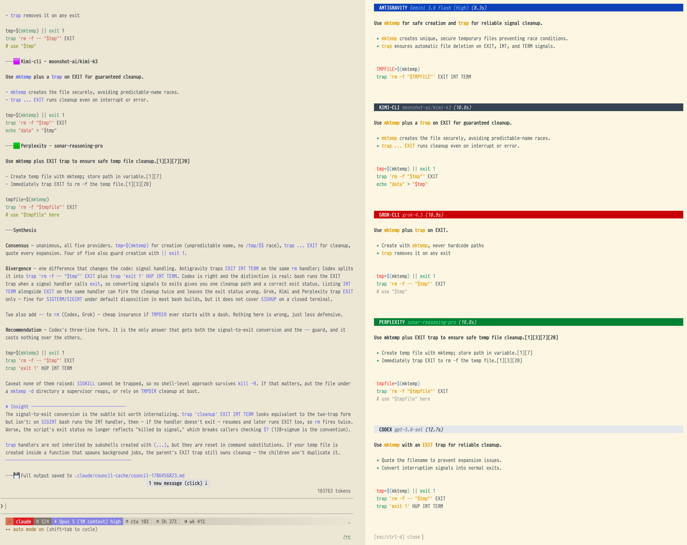

# Reference

Every flag, provider, variable and default. The [README](../README.md) covers install and the first run; [USAGE.md](USAGE.md) covers the workflows.

## Requirements

- `curl` and `jq` for API calls
- Valid API keys for at least one provider, OR `codex` / `agy` (Antigravity) / `grok` / `kimi` / `cursor-agent` CLI installed, OR `ollama` running locally. `--local` needs none of these: it runs on Claude alone
- Optional: a Rich-capable Python (`python3` with a modern `rich`, or `uv`) upgrades the tmux pane's markdown rendering; without it the built-in perl renderer is used
- macOS, Linux, or Windows via Git Bash; the test suite runs on all three in CI

## Running from a local clone

For normal use, install from the marketplace, which persists across sessions. A manual clone is for running from a local working copy
(development, or offline). Clone the repo **anywhere**, then point Claude Code
at the repo root for the current session:

```bash
git clone https://github.com/hex/claude-council.git
claude --plugin-dir /path/to/claude-council    # repo root; loaded for this session only
```

> **Cloned it and nothing loads?** Two traps to avoid:
> 1. **Don't clone into `~/.claude/plugins/`** (Windows:
>    `%USERPROFILE%\.claude\plugins\`). That's Claude Code's managed install
>    *cache* — it is never scanned for manually-added plugins, so the plugin
>    won't appear in the Installed tab or respond to its slash commands.
> 2. **`pluginDirectories` in `settings.json` does nothing** — it isn't a real
>    setting, so it's silently ignored (no error shown). Use `--plugin-dir`
>    above for a local clone, or install from the marketplace for a
>    persistent setup.

## Flags

| Flag | Description |
|------|-------------|
| `--providers=list` | Query specific providers (e.g., `gemini,openai,codex`). Naming one in plain words works too: "check with grok" runs the council with that provider alone. There is no `--grok` style flag |
| `--roles=list` | Assign roles (e.g., `security,performance`, a preset like `balanced`, or `provider=role` pairs) |
| `--debate` | Enable two-round debate mode |
| `--file=path` | Include specific file in context |
| `--image=path` | Attach one image (e.g. a screenshot) for vision-capable providers |
| `--output=path` | Export response to markdown file |
| `--quiet` | Show only synthesis, hide individual responses |
| `--agents` | Agent-enhanced analysis, one Claude analyst per provider (slower, deeper) |
| `--local` | Local Claude-only council when you have no provider keys (see [USAGE.md](USAGE.md#local-council---local)) |
| `--async` | Detach the query as a background job; fetch with `/claude-council:result` |
| `--no-cache` | Force fresh queries, skip cache |
| `--no-auto-context` | Disable automatic file detection |
| `--no-pane` | Disable streaming tmux pane (default: on inside tmux) |
| `--verbosity=LEVEL` | Response style: `brief` / `standard` / `detailed` |

## API Keys

Set environment variables (recommended):

```bash
export GEMINI_API_KEY="your-key"
export OPENAI_API_KEY="your-key"
export XAI_API_KEY="your-key"          # GROK_API_KEY also accepted
export PERPLEXITY_API_KEY="your-key"
export KIMI_API_KEY="your-key"         # MOONSHOT_API_KEY is read as a fallback,
                                       # but only KIMI_API_KEY makes kimi discoverable
export OPENROUTER_API_KEY="your-key"   # one key, any model on openrouter.ai/models
```

`openrouter` seats whatever model `OPENROUTER_MODEL` names, defaulting to
`anthropic/claude-fable-5.1` — the one vendor the council has no direct seat for.
To seat several routed models at once, list them instead:

```bash
export OPENROUTER_MODELS="deepseek/deepseek-v3.2,z-ai/glm-5.3,qwen/qwen3-max"
```

Each entry becomes its own council member — `openrouter-1`, `openrouter-2`,
`openrouter-3` — with its own header, model label, cache entry and role, all
sharing the one key. `--providers=openrouter-2` picks one out. The list replaces
the single `openrouter` seat rather than adding to it, so the same model never
answers twice under two headers. Reordering the list reassigns the numbers, which
matters only if you pin roles positionally. A seat that should accept images opts
in by number (`OPENROUTER_2_VISION=1`): the roster can hold any model, and nothing
in the id says whether it reads images.
Two things follow from it being a router. Your prompt reaches OpenRouter and then
the upstream serving that id, so it is two disclosures rather than one. And
pointing it at a model another seat already runs (`OPENROUTER_MODEL=openai/gpt-5.6`
alongside `OPENAI_API_KEY`) gives you two headers voicing one model: the synthesis
is told to read that agreement as possible duplication, not corroboration.

`ollama` needs no key at all: install it, pull a model, and it joins the council
as a local provider.

## CLI Providers (subscription auth, no API key)

If the `codex`, `agy`, `grok`, `kimi`, or `cursor-agent` CLIs are installed and on `PATH`, they're discovered automatically, and the four with an API sibling are **preferred over it** by default:

- `codex` (OpenAI Codex CLI) shadows the `openai` API provider — uses your `~/.codex/config.toml` model unless `CODEX_MODEL` is set
- `antigravity` (Antigravity CLI, `agy`) shadows the `gemini` API provider — uses the model selected in the Antigravity app unless `ANTIGRAVITY_MODEL` is set
- `grok-cli` (xAI Grok CLI, `grok`) shadows the `grok` API provider — uses the grok CLI's own default model unless `GROK_CLI_MODEL` is set
- `kimi-cli` (Kimi Code CLI, `kimi`) shadows the `kimi` API provider, using the kimi CLI's own configured model unless `KIMI_CLI_MODEL` is set
- `cursor-cli` (Cursor CLI, `cursor-agent`) has no API sibling; it uses the model picked in the CLI unless `CURSOR_CLI_MODEL` is set. A free Cursor plan runs `auto` only and rejects any named model. Discovery keys on `cursor-agent`, not the `agent` name the installer also links, because the grok CLI ships an `agent` too

`ollama` is also discovered from `PATH`, but it is local and keyless rather than subscription-backed, so it shadows nothing and has no API sibling.

**Claude CLI seat (`claude-cli`), opt-in.** Claude Code itself can sit on the council, on the Claude subscription you are already logged in with. Discovery never seats it, since every user of this plugin has `claude` on `PATH`; name it with `--providers=...,claude-cli` or in `COUNCIL_PROVIDERS`. It runs `claude -p --safe-mode --setting-sources "" --tools "" --no-session-persistence`, so it gets the same prompt as every other seat and none of your setup: no CLAUDE.md, settings, plugins, hooks (this plugin's Stop gate included), MCP servers or tools, and nothing lands in your session history. It uses the account's default model unless `CLAUDE_CLI_MODEL` is set, and has no API sibling to fall back to. Things to know before seating it:

- It draws on the same subscription limits as the session you are driving it from, and `--debate` makes two calls per question.
- It authenticates with your claude.ai login, or `CLAUDE_CODE_OAUTH_TOKEN` and `CLAUDE_CONFIG_DIR` when set. `ANTHROPIC_API_KEY` is never passed to it, so it never bills the API.
- If your Claude Code reaches Claude through Bedrock, Vertex or a gateway instead, the seat loses those settings to the same scrub. Name the variables it needs in `COUNCIL_PASS_ENV`, for example `COUNCIL_PASS_ENV=CLAUDE_CODE_USE_BEDROCK,AWS_REGION,AWS_PROFILE`.
- On a Team or Enterprise account it is not fully blind: your organisation's server-side instructions and managed policy settings still reach it, the same ones the driving session gets. No CLI flag removes them.
- Claude writes the synthesis too, so it counts this seat's agreement as one voice, not independent support.

**Copilot CLI seat (`copilot-cli`), opt-in.** The GitHub Copilot CLI can sit on the council, on your Copilot plan, through the login the CLI already has. Discovery never seats it, because each question spends one of the plan's premium requests; name it with `--providers=...,copilot-cli` or in `COUNCIL_PROVIDERS`. It runs `copilot --output-format json --no-auto-update --no-custom-instructions --disable-builtin-mcps --available-tools=none` with the prompt on stdin. The model gets no tools, built-in or MCP, and no `AGENTS.md` or other instruction files. The GitHub MCP server never connects, and the CLI never downloads an update during a seat run. It has no API sibling to fall back to. Things to know before seating it:

- Two things reach it that no flag removes. MCP servers in your `~/.copilot/mcp-config.json` still start, though the model gets none of their tools. The CLI also saves each run in your Copilot session history.
- It authenticates with `COPILOT_GITHUB_TOKEN` when set, else your stored login from `copilot login` or the GitHub CLI's `gh auth login`. Copilot reads the second by running `gh`, so `gh` must stay on `PATH`. The council passes `COPILOT_GITHUB_TOKEN`, `COPILOT_HOME`, `COPILOT_CLI_*`, and `GH_CONFIG_DIR`, `GH_HOST` and `COPILOT_GH_HOST` for a relocated or GitHub Enterprise `gh` login, and nothing else of yours: `GH_TOKEN` and `GITHUB_TOKEN` stay behind, so a token your shell exports for `gh` or `git` does not choose the account, and so does `COPILOT_ALLOW_ALL`, which would make the CLI load the working directory's hooks.
- With `COPILOT_CLI_MODEL` unset, the CLI picks the model per question, and two questions can get different models. The header shows `default`, not the model that answered. A named model can fail. On one plan, `--model` rejected every name tried, including a model the automatic pick had just used, and the seat reports the CLI's `is not available` error. A model saved with `copilot config model` did not change the pick in a seat run, so the council does not read it.
- `/claude-council:status` shows whether `copilot` is on `PATH`, not whether it has a login. The CLI has no status command, and a test prompt would spend a premium request. A seat without a login fails with the CLI's `No authentication information found` and the ways to log in.
- The automatic pick can be a Claude model, so the synthesis counts this seat's agreement the way it counts a router seat's.

CLI providers use your existing CLI subscription and need no API key. None of them meters a call except `copilot-cli`, where each question spends one of the plan's premium requests. To opt back into the API variant for a single call, pass it explicitly: `--providers=openai`, `--providers=gemini`, `--providers=grok`, or `--providers=kimi`. Listing both API and CLI together (e.g., `--providers=grok,grok-cli`) runs them side-by-side for comparison.

If a CLI provider fails at query time and its API sibling's key is set, the council automatically retries through that API sibling and marks the slot as a fallback: the answer is shown under the CLI slot with the API model's name, a "fell back to … API" note, and the CLI's own error as the reason; the pane row reads `fallback` with `<model> via <sibling> API`. The fallback is skipped when the sibling is already in your selected providers, so you never get the same vendor's answer twice.

**Grok CLI guards, and Docker Desktop.** `grok-cli.sh` runs grok with two guards: `--deny '*' --no-subagents`, which refuses every tool call at grok's permission layer (without it grok's file and shell tools run on your machine; `--tools ''` and `--permission-mode plan` do not stop them), and `--sandbox read-only`, grok's own OS profile on top. grok 1.0.46 refuses to start any sandbox profile when `/var/run/docker.sock` is a symlink, which Docker Desktop on macOS creates when "Allow the default Docker socket to be used" is on. When grok refuses to start because it cannot apply the sandbox (`could not apply the 'read-only' sandbox profile … Refusing to start`, as it does on that symlink), the provider runs once more on the deny rules alone, so the seat keeps answering; any other failure falls back to the `grok` API as usual. `/claude-council:status` probes grok-cli with `grok models`, which does not exercise the sandbox, so it reads Connected either way. To get the OS sandbox back, turn that Docker Desktop setting off (the `docker` CLI keeps working through `~/.docker/run/docker.sock`), or wait for a grok release that resolves the symlink. The seat also runs with `GROK_{CLAUDE,CURSOR}_{SKILLS,RULES,AGENTS,MCPS,HOOKS,SESSIONS}_ENABLED=0`: grok otherwise imports your Claude Code and Cursor hooks, rules, skills, agents, MCP servers and sessions, so your SessionStart and Stop hooks would run inside every council seat and your CLAUDE.md would shape its answer. grok's own `~/.grok` configuration still applies.

Override CLI model selection. Left unset, the council reads what each CLI has
selected — `~/.codex/config.toml` (or `$CODEX_HOME`), `~/.grok/config.toml`,
`~/.kimi-code/config.toml`, and agy's own settings — and names that model in
the response banner, so you can see which model answered without pinning one:

```bash
export CODEX_MODEL="gpt-5-codex"                # default: the codex CLI's own configured model
export ANTIGRAVITY_MODEL="Gemini 3.1 Pro (High)"  # default: the model selected in the Antigravity app
export GROK_CLI_MODEL="grok-4.3"                # default: the grok CLI's own default model
export KIMI_CLI_MODEL="kimi-k3"                 # default: the kimi CLI's own configured model
export CURSOR_CLI_MODEL="composer-2.5"          # default: the model picked in the Cursor CLI (paid plans only)
export CLAUDE_CLI_MODEL="fable"                 # default: the account's default model (settings.json is not read)
export COPILOT_CLI_MODEL="claude-sonnet-5.5"    # default: the CLI's automatic pick per question (settings.json is not read)
```

The Antigravity CLI cannot take its prompt on stdin — `--print` with no value
prints the help — so the prompt is the value of `-p` and rides the command line.
Windows caps that at 32k, which a `--file`-sized prompt would exceed
(CreateProcess fails with error 206), so past `COUNCIL_ARGV_LIMIT` (default
24000 chars) the prompt is written to a file and agy is told to read it. The
file gets a directory of its own, which is the only thing `--add-dir` opens to
the sandboxed agent, and it is removed when the run ends.

## Pinning a standing provider roster

Discovery enlists everything it finds, which is rarely what you want once more
than a couple of agents are installed. `COUNCIL_PROVIDERS` pins the default set;
an explicit `--providers` still overrides it per call.

```bash
export COUNCIL_PROVIDERS="codex,antigravity"  # queried by default, nothing else
```

`--list-default` and `--list-available` both report the pinned roster, so neither
tooling nor the human-readable view disagrees with what a query would actually
run. Spaces around the commas are fine, in the variable and in `--providers`
alike.

The Kimi CLI runs every prompt under an agent definition that grants it no tools
(`prompts/kimi-cli-agent.md`). Its print mode auto-approves tool calls, so the
council denies them outright rather than letting a prompt drive file writes or
shell commands. The Cursor CLI runs in `--mode ask`, its read-only mode, and is
never passed `--force`; its print mode otherwise has every tool, shell included.

## Model Selection

Override default models via environment variables:

```bash
export GEMINI_MODEL="gemini-flash-latest"           # default (tracks Google's current Flash)
export OPENAI_MODEL="gpt-6-astra"                   # default
export GROK_MODEL="grok-latest"                     # default (tracks xAI's current flagship)
export PERPLEXITY_MODEL="low"                       # default (Agent API preset, reasoning + search)
export KIMI_MODEL="kimi-k3"                         # default (reads images)
export KIMI_VISION=1                                # only needed when KIMI_MODEL
                                                    # names an image-capable model
                                                    # other than the default
export COUNCIL_AGENT_MODEL="sonnet"                 # default: the model the --agents
                                                    # ANALYSTS run on (sonnet/opus/haiku/fable).
                                                    # Not a provider model — see below.
export OPENROUTER_MODEL="anthropic/claude-fable-5.1"  # default (single seat)
export OPENROUTER_MODELS="a/b,c/d,e/f"              # or: one seat per entry
export OPENROUTER_2_MODEL="c/d-pinned"              # overrides roster seat 2's entry;
                                                    # what the exit-3 degrade path sets
export OPENROUTER_REASONING_TOKENS=8000             # thinking budget per request (default 8000; 0 lets the model decide)
export OPENROUTER_VISION=1                          # only needed when OPENROUTER_MODEL
                                                    # names a model that accepts images
export OPENROUTER_2_VISION=1                        # same, for roster seat 2
export OLLAMA_MODEL="llama3.2"                      # default: whichever model `ollama list` shows first
export OLLAMA_HOST="http://localhost:11434"         # default
export GEMINI_THINKING_BUDGET=8192                  # optional: cap Gemini's internal reasoning tokens (unset: the model decides)
```

`COUNCIL_AGENT_MODEL` is the odd one out: every other variable here names a model
that *answers* the question, while this one names the Claude analyst that wraps a
provider in `--agents` mode — it runs the query, judges the reply and returns a
structured analysis. It is pinned rather than inherited from your session, so the
cost of a mode that already spawns one agent per provider does not swing by a
factor of several depending on which model you happen to be running. One measured
run of eight seats came to ~456k analyst tokens.

Gemini and Grok default to their vendor's rolling alias, so the council follows
a new flagship without a release. Pin an explicit id when you need a fixed model
across runs: cached answers key on the id, so an alias can serve an answer the
model behind it no longer gives, and the response header names the alias rather
than the model that answered.

Response length cap (default: 2048; `ollama` uses 4096, since local reasoning
models spend much of the budget on thinking that never reaches the answer):

```bash
export COUNCIL_MAX_TOKENS=4096  # longer responses
export COUNCIL_MAX_TOKENS=1024  # shorter, faster responses
```

## Model fallback

If a provider's default model is unavailable for your API key or region, the
council answers with a verified fallback model instead of failing, and says so
in the response header:

```
## ● Grok - grok-4.6 (grok-latest unavailable)
```

| Provider | Default | Fallback |
|---|---|---|
| openai | `gpt-6-astra` | `gpt-6.1-sol` |
| grok | `grok-latest` | `grok-4.6` |
| gemini | `gemini-flash-latest` | `gemini-3.8-flash` |
| perplexity | `low` | `fast` |
| kimi | `kimi-k3` | `kimi-k2.6` |
| ollama | first local model (`OLLAMA_MODEL` to pin) | — |
| openrouter | `anthropic/claude-fable-5.1` | `anthropic/claude-opus-5.5` |

The same substitution is also noted on stderr and folded into the synthesis,
so it's visible even in quiet mode or a headless run. Setting `<PROVIDER>_MODEL`
explicitly disables the fallback for that provider — an explicit choice is
respected verbatim.

The verdict — "this model is unavailable for this key" — is cached for a day
so it isn't retried on every query, and the council returns to the default
automatically once it becomes available. This is a separate cache from the
[response cache](#response-caching) (`COUNCIL_CACHE_DIR` / `COUNCIL_CACHE_TTL`): it tracks
per-model availability, not full answers. Tune it with `COUNCIL_AVAILABILITY_TTL`
(seconds, default `86400`); set it to `0` to re-check on every query. It is
independent of `--no-cache`, which only forces fresh *answers*.

## Reasoning Models

For reasoning models from any provider, the token limit is automatically increased to 8x the base value (minimum 32768). This is because reasoning models combine internal thinking tokens and visible output tokens into a single `max_output_tokens` limit — without the bump, the model can run out mid-response.

The bump applies to:

- **OpenAI**: `codex-*`, `*-codex`, `o3-*`, `o4-*`, `gpt-5.[4-9]*`, `gpt-[6-9]*`
- **Gemini**: `gemini-3*`, `*thinking*`, `gemini-*-latest`
- **Grok**: `*reasoning*`, `grok-4*`, `grok-3-mini-*`, `grok-build-*`, `grok-latest`
- **Perplexity**: the `low`, `medium`, `high` and `xhigh` presets
- **Kimi**: `kimi-k*` (so the default model always triggers the bump)
- **OpenRouter**: every routed model. The seat can be pointed at any id, and a
  pattern list misses reasoning models whose names carry no tell
  (`z-ai/glm-5.3-flash`, `xiaomi/mimo-v2.5`), which then spend the whole base
  thinking and answer with nothing. `max_tokens` is a ceiling, not a spend, and
  OpenRouter clamps a value above an upstream's own limit rather than rejecting
  it, so the bump is free
- **Ollama**: `*r1*`, `*reason*`, `*gpt-oss*`, `qwen*`, `gemma*`, `deepseek*`

The OpenRouter seat also sends a thinking budget, `reasoning.max_tokens`, on
every request (default 8000; `OPENROUTER_REASONING_TOKENS` overrides it, `0`
sends none). The two caps do different jobs. `max_tokens` bounds thinking and
answer together, so a model can spend the whole cap thinking and answer with
nothing. The budget bounds the thinking alone, leaving room for the answer: a
routed model that would otherwise think for twenty thousand tokens on a long
prompt, and outlast `COUNCIL_TIMEOUT`, answers inside two minutes. Upstreams
without direct allocation map the number to an effort level, and adaptive
models ignore it.

| Model Type | COUNCIL_MAX_TOKENS | Actual Limit |
|------------|-------------------|--------------|
| Standard (gpt-5.1) | 2048 (default) | 2048 |
| Reasoning (gpt-6-astra) | 2048 (default) | 32768 |
| Reasoning (gpt-6-astra) | 4096 | 32768 |

Control reasoning effort to balance speed vs thoroughness:

```bash
export OPENAI_REASONING_EFFORT="low"     # faster, less reasoning overhead
export OPENAI_REASONING_EFFORT="medium"  # default - balanced
export OPENAI_REASONING_EFFORT="high"    # thorough reasoning, slower
```

Grok's token accounting depends on the model: `grok-build` counts thinking tokens separately, so `max_tokens` caps only its visible output; the other reasoning models (`grok-4*`, `*-reasoning`, `grok-3-mini-*`) share one budget between thinking and output. Either way, council bumps the cap for these models so a long answer isn't cut off mid-response.

## Perplexity Search Features

The Perplexity seat uses the Agent API (`/v1/agent`) with its `web_search` tool, so answers are web-grounded with inline citations. Sonar Chat Completions ended on 2026-09-27. The seat refuses an old `sonar-*` model id before any request and names the preset to use instead.

```bash
# Filter search results by recency: day, week, month, year
export PERPLEXITY_RECENCY="week"
```

`PERPLEXITY_MODEL` takes an Agent API preset or a `provider/model` id:
- `fast` - quick search answers (Perplexity's replacement for `sonar` and `sonar-pro`)
- `low` - reasoning + search (replaces `sonar-reasoning-pro`, default)
- `medium`, `high`, `xhigh` - deeper research, slower and costlier
- a `provider/model` id such as `perplexity/sonar`, sent as `model` with web search still on

Perplexity is useful when you need current information (latest framework versions, recent best practices) rather than just training-data knowledge.

## Response Caching

Responses are automatically cached to speed up repeated queries and save API costs:

```bash
# Uses cache if available (default)
/claude-council:ask "What's the best testing framework?"

# Force fresh queries, skip cache
/claude-council:ask --no-cache "What's the best testing framework?"
```

Cache configuration:
```bash
export COUNCIL_CACHE_DIR=".claude/council-cache"  # Cache location (default)
export COUNCIL_CACHE_TTL=3600                      # Cache lifetime in seconds (default: 1 hour)
```

Cached responses show `cached` instead of `success` in the status output. Cache is keyed by prompt + provider + model + role, so:
- Changing models invalidates the cache
- Using `--roles` creates separate cache entries (same prompt with different role = cache miss)
- Debate mode round 2 rebuttals are not cached (they depend on round 1 content) — with one exception: if a CLI provider fails in round 2 and falls back to its API sibling, that fallback rebuttal is cached, keyed on the full debate prompt (which already includes the round 1 answers)

Privacy: cache entries and the saved `council-*.md` transcripts store the **full prompt in cleartext** — including any files you pass with `--file` and the auto-included context. Council drops a `.gitignore` (`*`) into the cache dir so these never get committed, but the plaintext still lives on local disk under `COUNCIL_CACHE_DIR`. The first cached run after an entry passes `COUNCIL_CACHE_TTL` deletes it; a transcript stays until you delete it.

## Retry & Timeout

Automatic retry on transient failures (429 rate limits, 5xx server errors):

```bash
export COUNCIL_MAX_RETRIES=3    # default: 3 retries
export COUNCIL_RETRY_DELAY=1    # default: 1 second initial delay (doubles each retry)
export COUNCIL_TIMEOUT=300      # default: 300 seconds per API request
export COUNCIL_CLI_TIMEOUT=1200 # default: 1200 seconds per CLI-provider run
```

Timeouts fail fast (no retry) to prevent blocking on hung providers.

Retries apply to the API providers, whose requests go through `curl`; a
transient 429 or 5xx is worth another attempt. The CLI providers get a single
attempt, because a CLI that is merely slow is not a transient failure and
retrying it multiplies the wait. That is why their default bound is higher: an
API provider may spend up to `(COUNCIL_MAX_RETRIES + 1) × COUNCIL_TIMEOUT`,
so one shared number would give a CLI a deadline four times stricter. Setting
`COUNCIL_TIMEOUT` explicitly overrides both.

CLI providers reading a large `--file` are the ones that hit this — a 64KB
payload has taken kimi past fifteen minutes.

## Provider environment

Each provider runs with only the environment it needs: the basics (`PATH`,
`HOME`, `USER`, `TMPDIR`, `TERM`, `LANG`, `LC_*`, `XDG_*` and a few more),
proxy and CA-bundle settings, the Windows variables Git Bash needs, every
`COUNCIL_*` setting, and its own vendor's variables (`GEMINI_*` and
`GOOGLE_*` for Gemini and Antigravity, `XAI_*` and `GROK_*` for Grok, and so
on). Another vendor's key, and any other secret your shell exports, does not
reach it. If a CLI provider needs something else from your environment, name
it:

```bash
export COUNCIL_PASS_ENV=NODE_OPTIONS,EXAMPLE_VAR   # comma-separated names passed to every provider
```

## Display & Terminal Integration

When run inside tmux, council opens a streaming side pane that shows live provider status (`querying`, `complete`, `fallback`, `cached`, `error`, `cancelled` with timing) and renders each response as it lands. Rendering prefers [Rich](https://github.com/Textualize/rich) when a Rich-capable Python is available (`python3` with a modern `rich` installed, or [`uv`](https://docs.astral.sh/uv/), which fetches it on demand): word-wrapped prose, tables fitted to the pane width, syntax-highlighted code, clickable links — styled with your terminal's own palette (cyan headings, yellow code, vendor-colored banners). Without one, a built-in dependency-free perl markdown renderer takes over with the same visual language, so nothing needs to be installed. Press **Esc** or **Ctrl-D** to close the pane.



Five providers answering in the tmux pane on the right, each banner naming the
model and its time, with the synthesis in the chat on the left.

A provider that fails shows its error text under a `✗ <provider> error` heading. A CLI seat whose API sibling answered shows an amber `↪ <provider> fell back` notice with the reason (the CLI's error text, or that the image went to a vision model), then the answer; it does not count as failed for the retry offer. When any provider has failed, the pane then offers `[r] retry failed (<providers>) · [esc/ctrl-d] close` with a countdown: **r** re-queries only the failed providers inside the same run, so a recovered answer reaches the synthesis, the saved transcript and the cache like any other; **Esc** closes the pane and the run carries on with what it has. The offer stays open for `COUNCIL_RETRY_WAIT` seconds (default 45; `0` disables it) and is made once per run. The run waits while the offer is open, so a retry extends the council's wall time by another provider round. `--async` jobs default to `0`: nobody is committed to answering a detached run's pane, so it never waits.

A seat that is taking too long can be cancelled from the Claude Code pane, or every seat still out at once from its band (the [mod README](../mods/council-pane/README.md) has the keys): the run ends that seat's process tree, the row reads `cancelled` in grey, the summary counts it apart from the errors, and the retry offer does not name it. In the result JSON and the formatted output the seat is an error whose text reads `cancelled from the pane`, so the synthesis leaves it out like any seat without an answer; a seat cancelled in round 1 sits out the debate round and gets no rebuttal block. A press that lands after the seat has answered keeps the answer, and a seat that traps the signal is killed five seconds on. Only round 1 can be cancelled: the debate round draws no rows. The tmux pane shows a cancelled seat but has no key to cancel one.

Resizing the window reflows the pane. Wrap width is chosen when a response is rendered, so answers that landed at different widths would otherwise sit side by side at different widths; once the new width has held still for about half a second, every answer so far is re-rendered to it, at the close prompt as well as mid-run. The wait is deliberate: dragging a pane border reports a stream of intermediate widths, and re-rendering each one would cost a second of work and your scrollback every time. The redraw clears the pane's scrollback along with the screen, which resets copy-mode position.

Colors adapt to your terminal theme: the pane detects the background
(OSC 11 query, `COLORFGBG` fallback). The Rich renderer flips its
code-highlighting theme to match; the perl renderer renders bold/italic
emphasis bright on dark themes, dark on light themes, and attribute-only when
undetectable, with muted text (link URLs, table grid lines, `---` rules,
sub-headings, the "waiting on" label) following suit — faint/bright-black on
dark, a readable dark gray on light.
Force it with `COUNCIL_THEME=light` or `COUNCIL_THEME=dark`.

When the outer terminal is iTerm2, council also drives:

- **Tab color** — yellow while querying, green on success, red if any provider errored. Set via `it2setcolor`; ambient state signal without looking at the terminal.
- **Dock attention** — bounces the iTerm2 dock icon when council finishes if the run took longer than `COUNCIL_ATTENTION_THRESHOLD` (default 2000ms). Useful for slow `--debate` queries when you've switched apps.
- **`SetMark` navigation** — emits OSC 1337 SetMark before each provider response inside the pane. Cmd+Shift+↑/↓ in iTerm2 jumps between provider sections.

```bash
export COUNCIL_NO_PANE=1                # disable the streaming pane globally
export COUNCIL_RENDERER=perl             # force the built-in perl renderer
export COUNCIL_ATTENTION_THRESHOLD=5000  # only bounce dock if run > 5s
export COUNCIL_RETRY_WAIT=45             # seconds the pane's retry offer stays open (0 disables)
```

Per-call opt-out via `--no-pane`. iTerm2 features no-op silently outside iTerm2; pane no-ops outside tmux.

When a pane (tmux or the one inside Claude Code) streamed the answers, the chat does not reprint them afterwards. It shows one status line per provider, any `--debate` rebuttals, and the synthesis. The saved transcript still holds every answer.

### Pane inside Claude Code (experimental)

`mods/council-pane` is a Claude Code mod that draws the same pane inside Claude Code, without tmux. It ships with the plugin and loads when Claude Code runs with `CLAUDE_CODE_ENABLE_FUNCTION_HOOKS=1`; mods are early access, so without that variable nothing changes. Its [README](../mods/council-pane/README.md) lists the settings and the limits.

The scripts support it through one variable. When `COUNCIL_MOD_PANE_DIR` names an existing directory, a run writes its watch directory there and does not open tmux. `--no-pane` and `COUNCIL_NO_PANE=1` still win. Only the mod sets the variable.

## Direct Script Usage

Use the scripts directly without Claude Code (for automation, CI, or debugging):

```bash
# Basic query - returns JSON
bash scripts/query-council.sh -- "What is dependency injection?"

# With flags
bash scripts/query-council.sh --providers=gemini,openai --roles=balanced -- "Review this pattern"

# Resolve this session's transcript, then digest a window of it
bash scripts/session-transcript.sh <session-id>
bash scripts/transcript-digest.sh --turns last:25 <path/to/transcript.jsonl>

# Pipe to formatter for terminal display
bash scripts/query-council.sh --providers=gemini -- "Question" 2>/dev/null | bash scripts/format-output.sh

# Check provider status. A passed key check for Gemini, OpenAI, Grok or Kimi is
# followed by one chat request capped at 16 output tokens, since a models
# listing answers for a key whose account cannot run inference; Perplexity's
# only check is such a request. Each costs a fraction of a cent.
bash scripts/check-status.sh

# List configured providers (human-readable, with policy info)
bash scripts/query-council.sh --list-available

# List the providers that would be queried by default (machine-readable)
bash scripts/query-council.sh --list-default

# Same set, each paired with the model it would send: "<provider>\t<model>" per
# line. Router seats carry no model in their name, so this is what a picker or
# any other tool needs to label them.
bash scripts/query-council.sh --list-default-models
```

**JSON output structure:**
```json
{
  "metadata": {
    "prompt": "...",
    "file_path": null,
    "roles_used": ["security", "performance"],
    "debate_mode": false,
    "quiet_mode": false,
    "pane_shown": false,
    "output_path": null,
    "auto_context": true,
    "timestamp": "2025-12-18T12:00:00Z"
  },
  "round1": {
    "gemini": { "status": "success", "response": "...", "model": "...", "role": "security", "cached": false, "model_fallback": null },
    "openai": { "status": "error", "error": "...", "model": "...", "role": "performance", "cached": false }
  },
  "round2": { ... }  // Only present if --debate
}
```

`model_fallback` names the preferred model when it was unavailable and a fallback model answered. A CLI seat answered by its API sibling also carries `fallback` (the sibling's name) and `fallback_reason` (the CLI's error text, or that the image went to a vision model).
