# council-pane

A Claude Code mod that draws the council's streaming pane inside Claude Code, so it works without tmux.

Mods are early access. You need `CLAUDE_CODE_ENABLE_FUNCTION_HOOKS=1`, and the API can change between Claude Code releases. The heads-up side-check needs Claude Code 2.1.302 or later; the rest of the mod runs on 2.1.278. The tmux pane is still the default and nothing here replaces it.

## Run it

The mod ships with the plugin: `hooks/hooks.json` at the repo root names `pane.tsx` as a module, so an installed council loads it whenever the variable is set. Without the variable Claude Code skips the module and the tmux pane works as before.

```
CLAUDE_CODE_ENABLE_FUNCTION_HOOKS=1 claude
```

Then run `/claude-council:ask` as usual. From a checkout, add `--plugin-dir .` to run this tree's copy over the installed one.

## How it hooks in

At session start the mod creates a directory under `$TMPDIR`. Just before Claude runs `run-council.sh`, the mod sets `COUNCIL_MOD_PANE_DIR` to that directory, or clears it when the pane belongs to tmux. The run inherits it.

When the variable is set, `run-council.sh` writes its watch directory there and skips tmux. The mod polls that directory twice a second and draws what it finds. The files are the same ones the tmux watcher reads, plus a few the mod needs:

| File | Written by | Holds |
|---|---|---|
| `status` | the run | one line per provider event: name, state (`querying`, `complete`, `cached`, `error`, `fallback`, `cancelled`), milliseconds, model. A `fallback` line's model reads `<model> via <sibling> API` |
| `responses/<name>.md` | the run | each answer |
| `errors/<name>.txt` | the run | each error, and for a seat its API sibling answered, why the seat itself did not. A cancelled seat has none: the run removes it |
| `colors` | the run | each provider's banner color as `r;g;b` |
| `pid` | the run | the run's process id, so a run that was killed is not waited on |
| `job-id` | an `--async` run | the background job's id |
| `job-file` | an `--async` run | the path of the job's record, which says when the result can be fetched |
| `retry-offer` | the run | seconds the offer stays open, then the failed providers |
| `.retry` / `.retry-declined` | the pane | the answer to the offer |
| `cancel/<name>` | the pane | cancel that seat. The run removes it once the seat is logged `cancelled`, or at once if the seat's answer was already written or the seat had already ended; a marker that lands after the run stopped waiting on its seats stays, and goes with the watch dir |
| `retriable/<name>` | the run | that seat failed and a row press can re-query it: written while the run still waits on other seats, removed at the relaunch or when the run stops waiting. The pane shows the row's `retry` only for a name listed here |
| `retry/<name>` | the pane | re-query that seat from its error row. The run removes it at the relaunch; one that lands after the run stopped waiting stays, and the band's offer takes over |
| `.done` | the run | the run has finished |

Without the mod the variable is never set and the scripts behave as before.

## What you get



Five fixture seats in a real Claude Code host. The status rows show cancel
buttons while seats query and a retry button for the failed seat. Answers
fold when the synthesis arrives. The band above the prompt tracks the run.

- A status list with one row per provider, in the provider's color. A provider still querying shows a spinner, a running time and a `cancel` button at the row's right edge: click it, or press ctrl+x tab and then the row's digit (`1` to `9`, then `0` for the tenth), to end that seat and go on without it. The row reads `cancelling` until the run confirms, then `cancelled` in grey with a hollow `○`. A seat that failed while others are still out shows a `retry` button in the same slot, with the same digit: it re-queries that seat with the query it failed, once; the row reads `retrying` until the run logs it querying again. Once the last seat ends the row has no button, and the band's own retry offer takes over for the seats that failed. When the run ends it collapses to one summary line and a row of names. A seat its API sibling answered counts as answered, and the summary says how many fell back and how many were cancelled.
- A banner per answer with the model and the time it took. Errors show in red. Each answer, error and the synthesis can be closed to its header line and opened again: click the header (`▾` open, `▸` closed), or press ctrl+x tab, reach it with Tab or the arrows and press Enter. With two or more of them, an `a: collapse all` / `a: expand all` button above the first does them all at once; click it, or press `a` in the focused pane. When the synthesis lands, the answers and errors close so it reads near the top; a jump from the row of names opens the section it lands on. A new run starts with every section open. When a CLI seat fails and its API sibling answers, a dim amber `<name> fell back: <reason>` line sits between the banner and the answer.
- Tables wider than the pane are rewritten as one record per row. Claude Code sizes tables to the terminal, so a wide one wraps into noise otherwise.
- The pane holds at most 80,000 characters, counted after wide tables are rewritten for its width. Claude Code refuses to draw a pane carrying more than 100,000 and draws its own instead, so over the budget the answers are cut to an even share, each ending with how many characters were left out; the synthesis, banners and errors are never cut, a closed section counts only its header line, and `/claude-council:result` has every answer whole.
- The synthesis, below the answers, once Claude has written it. With `collapse_when_done` on, press `0` to jump to it.
- While a run is live, a `COUNCIL` band above the prompt reads: how many providers finished (`3 of 6`, an error or a cancelled seat counting as finished), a thin line that fills with them, an `m:ss` clock since the run started, the latest event (`gemini answered`, `asking kimi`, `grok-cli answered through its API`), a `c · cancel all` button while any seat is still querying, and a button to open the pane. Cancel all presses every querying row's cancel at once, with no confirmation, as clicking each row would; click it, or press ctrl+x tab and then `c`. On a narrow pane the event gives way first. The pane lists who is still out.
- `retry` and `skip` buttons with a countdown bar when a provider fails. They sit in the band above the prompt, so they stay in view while the pane scrolls. Click them, or press ctrl+x tab to give the band the keys and then `r` or `s`. Typing goes to the prompt until you do.
- Press `1` to `9` in the focused pane to jump to that provider's answer once the run is done and the rows have collapsed; while it is live the same digits cancel that seat, and `0` cancels the tenth. Once the run is done `0` jumps to the synthesis, so a tenth seat has no jump key.
- When a run ends, a `COUNCIL` notice sits above the prompt for 20 seconds with buttons to open the pane or dismiss it. This covers `--async` jobs too, and the notice names the job.
- `/council-pane` reopens the pane with the last run.
- `/heads-up [setup | on [seat] | off | status]` sets the heads-up side-check up in Claude Code's own dialogs, switches it on for this project naming the one seat to ask, or off, or shows its state and counts. See [Heads-up side-check](#heads-up-side-check).

## Settings

They show up in `/config`. Changing one reloads the mod.

| Setting | Default | What it does |
|---|---|---|
| `pane_host` | `ask` | Where the pane opens. `claude-code` always draws it here, `tmux` always leaves it to tmux. `ask` puts the question once, the first time a run starts inside tmux, and remembers the answer across sessions; the row's label shows what it remembered. `/council-pane ask` forgets it. Outside tmux, `ask` opens the pane here without asking. |
| `collapse_when_done` | on | Off keeps the full status list after a run. |
| `wake_on_async_done` | off | Submits a prompt when a background job's result can be fetched. That starts a model turn and costs tokens. A job that fails wakes nobody. |
| `council_tool` | on | Registers `mcp__claude-council__ask` so the model can call the council as a tool. Each call asks you first. |
| `heads_up` | off | Turns the heads-up side-check on in every project. A project's `.claude/council-heads-up.json` overrides it for that project. See [Heads-up side-check](#heads-up-side-check). |

The council sends your question to third-party providers, and a tool is easier for the model to call unprompted than a slash command. Every call opens a dialog quoting the question and naming the providers, and nothing leaves the machine unless you choose `Send to the council`. `Don't send` or dismissing the dialog refuses the call. Anything you type under Other goes back to the model as a plain tool result, not a refusal, so it reads as your answer rather than an error. A `claude -p` run has no one to ask and gets the same refusal.

## Heads-up side-check

Off by default. Two switches: the `/config` row "Heads-up side-check" (`heads_up`) turns it on everywhere, and a project's `.claude/council-heads-up.json` turns it on or off for that project and picks the seat and cadence: `{"enabled": true, "seat": "codex", "every": 3}` (`enabled` optional, `true` on, `false` off whatever the row says, absent follows the row; `seat` defaults to `codex`, `every` to 3, at least 2). A file that does not parse, a seat name that is not a plain lowercase word, or a `seats` or `models` key keeps it off and logs the reason once, with the row on too. Either switch is the consent; [HEADS-UP.md](HEADS-UP.md) is the design.

On the main loop's `turn.step`, every `every` model requests into a turn (the step's own index), the mod forks `scripts/heads-up.sh` with the session id, the seat and an avoid list of topics already shown. The request is never held up. While a check runs no other starts; a turn gets at most one note. The poll reads `result.json` once `.done` lands, or reports the check failed once the worker or its dir has vanished, and removes the dir. A check whose seat failed logs one `heads-up:` line with the reason and shows it in red above the prompt for 20 seconds, with `x` to dismiss; a check that found nothing puts `heads-up: <seat> read <KB> in <s>, nothing to flag` on the dim hint under the empty prompt until the next keystroke or check.

`/heads-up setup` asks the engine's own dialog (scope: this project, every project, off here; seat, a single choice: the providers the council's own discovery finds here, codex first, four at most, a typed seat under Other; cadence: 3, 6, 9 or a typed number; the seat's model, codex's from `codex debug models`, and for codex an effort) and writes the file, the pick under `model` (`{model, effort}`, left out when empty; the runner gets it as `--model FILE`, exports the seat's `*_MODEL` and passes codex `-c model_reasoning_effort`), plus the `/config` row for every project, which reloads the mod. `/heads-up on` and `/heads-up off` write the project file with `enabled` set and its other fields kept, and `/heads-up on <seat>` also sets `seat` (one plain provider name, checked before the write; two names get the usage line instead) and drops a `model` picked for another seat; `/heads-up` or `/heads-up status` prints the effective state, which switch set it, the seat with its pick and the cadence, then the counts the mod keeps in the plugin store under `heads-up-counts` (checks, none, notes, repeats, failed, learn, tell, knew, dismiss, turned off, typed past; a read-add-write per event, so two sessions bumping at once can lose one). Nothing leaves the machine. The first session where the check is off adds `Tip: /heads-up on lets another model watch long turns and flag what Claude missed` to the dim hint under the empty prompt until the first typed character; the store flag `heads-up-intro-shown` keeps it from coming back.

A note sits above the prompt, after the finished and retry rows and before the progress band: `✦ <tag> · <headline>` (the mark in the council colour, the tag bold: `Heads up` for this session's work, `You should know` for a concept that matters; the sentence wrapped under its first word), then the choices with the seat, its model, payload and time dimmed after them: `1: Learn more`, `2: Knew this already`, a dim `4: Turn off` (two presses, the second writes the project file off) and `0: Dismiss`. Learn more opens the note the way the builtin does, a bold title and three to six bullets with the action bold last, with `1: Tell Claude` and `0: Close`; tell Claude puts a draft quoting the note in the prompt box, and the person sends or edits it; nothing is hidden and nothing is sent for them. A prompt you type while a note shows is typing past it, and the mod skips that many later checks. The plugin store keeps seen and known topics across sessions, 50 each; the session's own state is in `$.state` under `claude-council.headsUp`, declared in `types/index.d.ts`.

The rules live in `hooks/heads-up.ts`, with their tests in `tests/heads-up.test.ts`; `pane.tsx` only feeds them events.

## Limits

- A run that is killed outright writes no `.done`. The mod checks the run's pid every five seconds and, once the process is gone, shows `stopped before it finished` and moves on.
- The pane follows one run at a time. If a second run starts while one is live, the pane picks it up when the first ends.
- Saving a file in the mod or changing a setting reloads it and clears the pane. Run `/claude-council:ask` again.
- The mod parses the synthesis out of Claude's reply, between the `## Synthesis` heading and the `Full output saved` line. If the council skill changes that format, the section stops appearing.
- Answer bodies use Claude Code's own markdown styling. The Rich renderer's fitted tables and code highlighting are tmux only.
- The mod cuts a single paragraph over 10,000 characters mid-text, because one `Markdown` element holds no more than that. A cut inside a code fence breaks the rendering of what follows.
- The drawing has no automated test. `claude plugin test` exists from Claude Code 2.1.295, but no test here imports its kit from `claude-code/testing`. `bun test` covers the logic. Only a person looking at the pane checks the drawing.

## Development

```
(cd mods/council-pane && bun test && bunx tsc -p .)
claude plugin validate .
```

The types come from `/plugin-types`, which writes `.claude/types/` at the repo root. Regenerate them after a Claude Code update. The heads-up state needs types from 2.1.302 or later, which declare `$.state`, `atom`, `read` and `update`. `claude plugin validate` checks the `$.state` key against `types/index.d.ts`, which `.claude-plugin/plugin.json` names under `"types"`. Run with `--debug` and look for `claude-council` in the log when something does not draw.

Colours, type, glyphs and components follow [DESIGN.md](DESIGN.md), and every colour lives in `hooks/theme.ts`. Most are the engine's own theme keys, so the mod follows a light, dark or colour-blind theme and keeps its contrast on each.

`claude plugin validate` enforces one rule `tsc` does not: you can pass `$` only to functions declared at the top of the hooks module, never to a closure inside `register`.
